<p align="center">
  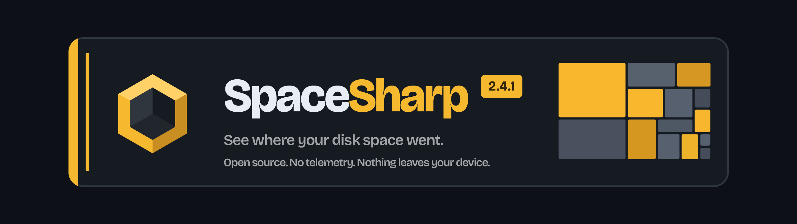
</p>

<p align="center">
  <b>See where your disk space went.</b><br>
  A fast, zoomable treemap of your drives, in the spirit of <a href="https://www.stardock.com/products/spacemonger/">SpaceMonger</a>.
</p>

<p align="center">
  <a href="https://github.com/SpaceSharpApp/SpaceSharp/releases/latest"></a>
  <a href="https://github.com/SpaceSharpApp/SpaceSharp/actions/workflows/tests.yml"></a>
  <a href="LICENSE"></a>
  
  
  
  
</p>

<p align="center">
  <a href="https://github.com/SpaceSharpApp/SpaceSharp/releases/latest"></a>
  <a href="https://spacesharp.app/"></a>
  <a href="https://docs.spacesharp.app/"></a>
  <a href="CHANGELOG.md"></a>
</p>

<p align="center">
  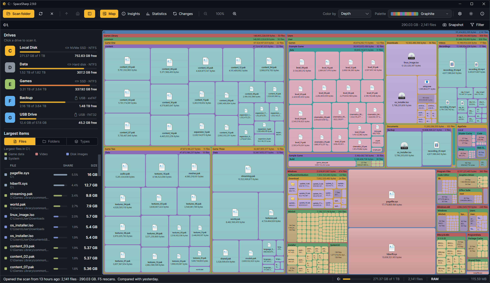
  <br>
  <sub>Every file and folder is a box sized by the space it uses. Sample data.</sub>
</p>

Your drive is full and you do not know why. SpaceSharp reads it in seconds and draws it as one picture: folders are frames, files are boxes inside them, and the biggest boxes are where the space went. Zoom in, filter in plain words, see what changed since last time, and send what you do not need to the Recycle Bin without leaving the map.

One portable `.exe` or a self-updating installer. Free, open source, code-signed, and it sends nothing anywhere.

## What it does

- **Scans a terabyte in seconds.** The NTFS file table is read directly; a parallel folder walk covers everything else, drawing the map while it runs.
- **One map, two ways to draw it.** Classic (square boxes and a grid) or Modern (rounded cards with file icons and labels that shrink with the box); Physical sizing by bytes or Uniform, where every file in a folder is drawn the same. Twenty-four palettes, five shading looks, and an editor for your own colors.
- **Filters in plain words.** `videos over 1GB older than a year` dims everything else and keeps the layout. A drawer writes the same filter from tiles and scales.
- **Tells you what is safe to clear.** Insights lists the usual suspects with the space they hold, finds empty folders and duplicate files, and every row is a click back to the map.
- **Shows the scan as a report.** Statistics lays out the files by size class, kind and age, the biggest extensions and the largest files and folders, SpaceMonger style; every figure opens the map filtered to it, and with a compared scan every figure carries its change.
- **Remembers every scan.** Yesterday's map is one click away, and Changes lays two scans side by side, folder by folder.
- **Cleans up without surprises.** Everything goes to the Recycle Bin and the map updates in place; anything touching Windows, program or app folders always asks first. Delete permanently reaches the folders Explorer cannot open.
- **Exports a table.** Any folder, the largest files, the filter's matches or the changes, as CSV or TSV with the columns you pick, or straight to the clipboard.

## A tour

<table align="center">
  <tr>
    <td align="center" width="50%"><a href="docs/shot-start.png">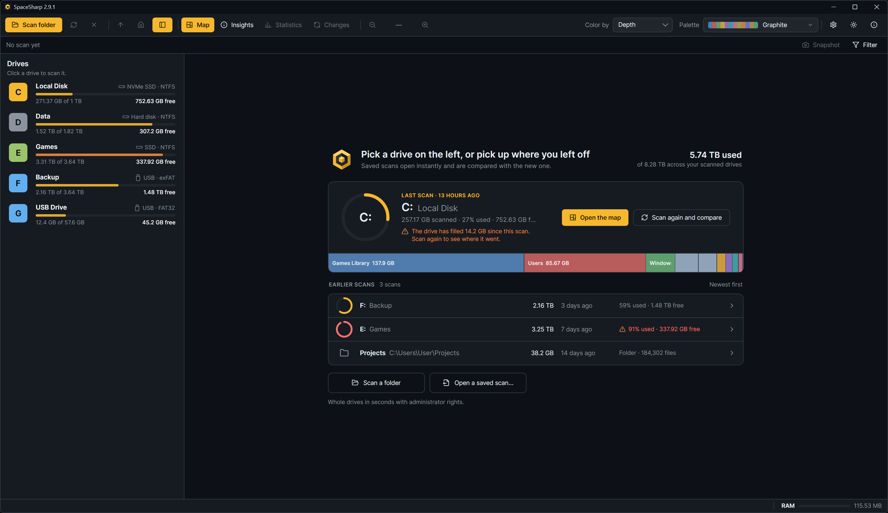</a><br><sub><b>Start.</b> Your last scan ready to open, the earlier ones under it, how full every drive is.</sub></td>
    <td align="center" width="50%"><a href="docs/shot-insights.png">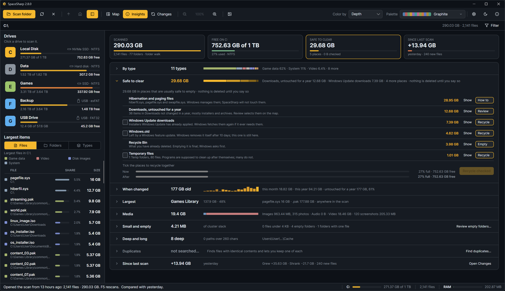</a><br><sub><b>Insights.</b> The map swapped for the numbers, every row a click back to it.</sub></td>
  </tr>
  <tr>
    <td align="center"><a href="docs/shot-filter.png">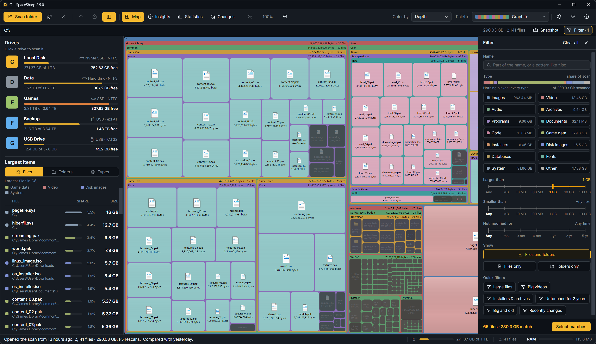</a><br><sub><b>Filter.</b> Pick types, set size and age, and the map dims to the matches.</sub></td>
    <td align="center"><a href="docs/shot-changes.png">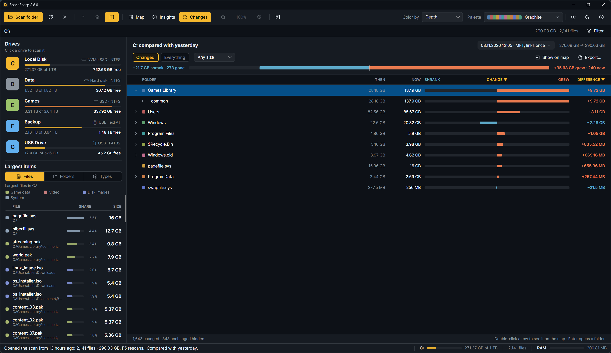</a><br><sub><b>Changes.</b> Then, now and the difference, folder by folder.</sub></td>
  </tr>
  <tr>
    <td align="center"><a href="docs/shot-inspect.png">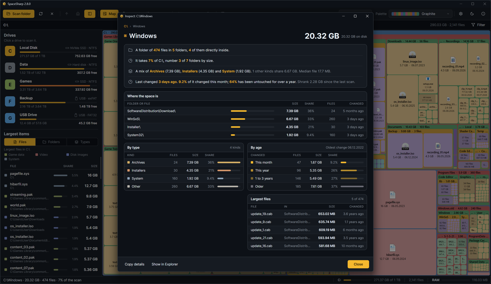</a><br><sub><b>Inspect.</b> Where the space is, by type and by age.</sub></td>
    <td align="center"><a href="docs/shot-menu.png">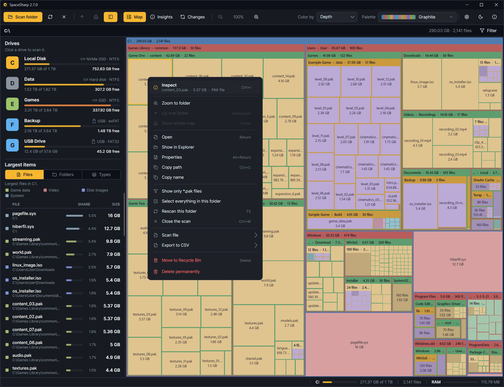</a><br><sub><b>Right-click.</b> The item's facts and share, then only the rows that apply.</sub></td>
  </tr>
  <tr>
    <td align="center"><a href="docs/shot-duplicates.png">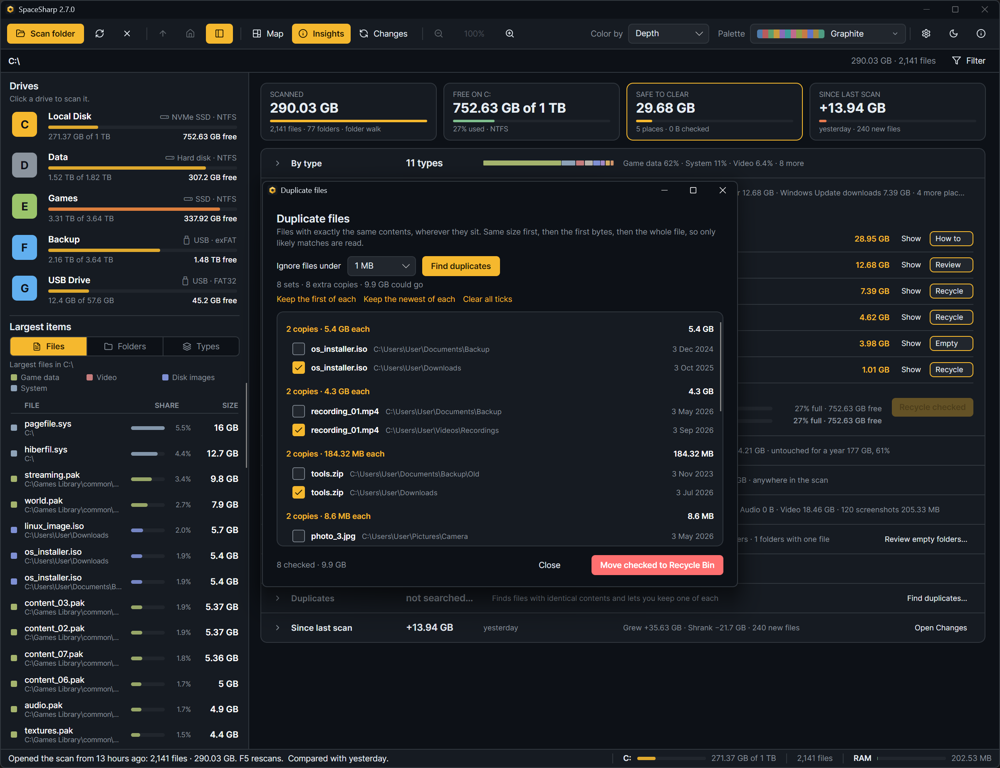</a><br><sub><b>Duplicates.</b> Files kept twice, in sets; keep the first or the newest with one click.</sub></td>
    <td align="center"><a href="docs/shot-settings.png">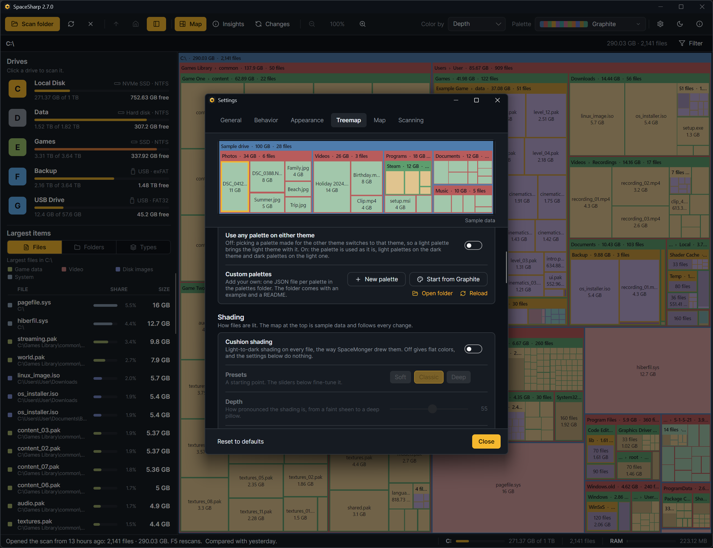</a><br><sub><b>Settings.</b> Every change shows in the preview as you make it.</sub></td>
  </tr>
  <tr>
    <td align="center"><a href="docs/shot-light.png">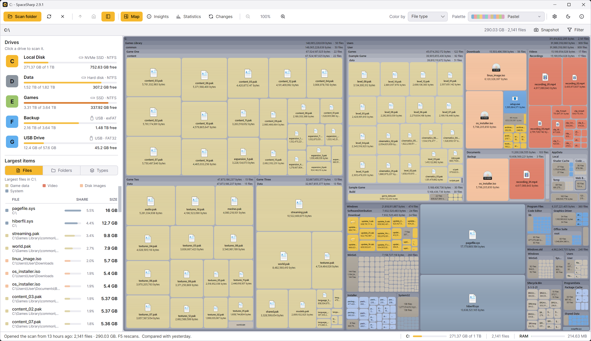</a><br><sub><b>Light theme.</b> Colored by file type, with the Pastel palette.</sub></td>
    <td align="center"><a href="docs/shot-about.png">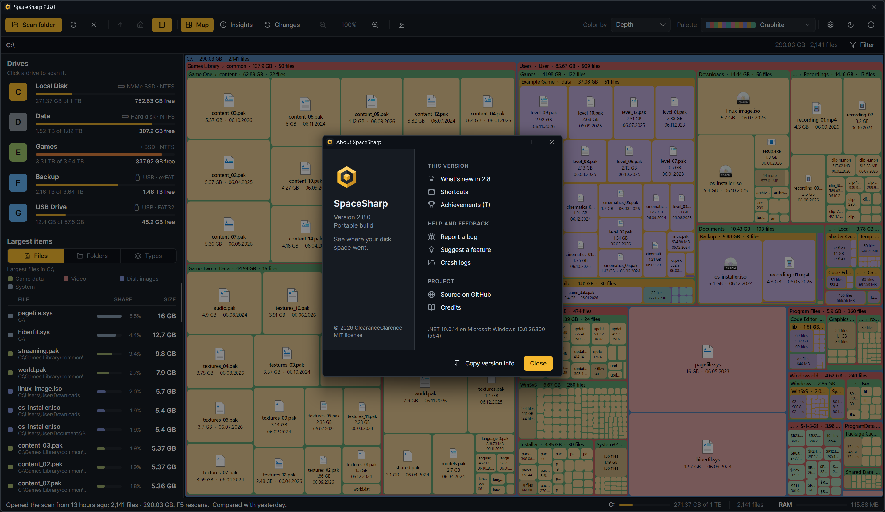</a><br><sub><b>About.</b> Version, update, credits, the keyboard map and the achievements.</sub></td>
  </tr>
</table>

## Download

For 64-bit Windows 10 and 11, from the [latest release](https://github.com/SpaceSharpApp/SpaceSharp/releases/latest).

| File | Best for |
|---|---|
| **[SpaceSharp-win-x64.exe](https://github.com/SpaceSharpApp/SpaceSharp/releases/latest/download/SpaceSharp-win-x64.exe)** | One portable file. Nothing to install; you download new versions yourself. |
| **[SpaceSharp-win-x64-Setup.exe](https://github.com/SpaceSharpApp/SpaceSharp/releases/latest/download/SpaceSharp-win-x64-Setup.exe)** | One-click install to your profile, no admin rights, updates itself. |
| **[SpaceSharp-win-x64.msi](https://github.com/SpaceSharpApp/SpaceSharp/releases/latest/download/SpaceSharp-win-x64.msi)** | A regular installer: choose the folder, for you or for everyone. Updates itself. |

Or from a package manager:

```powershell
winget install ClearanceClarence.SpaceSharp
```

```powershell
scoop bucket add spacesharp https://github.com/SpaceSharpApp/scoop-bucket
scoop install spacesharp/spacesharp
```

32-bit Windows gets the same three with **x86** in the name. SmartScreen may ask for **More info › Run anyway** while a new certificate earns its reputation.

**Requirements:** Windows 10 or 11, 64-bit or 32-bit (Windows on ARM runs the x64 build through emulation). Nothing else to install: the .NET runtime ships inside every download. Administrator rights are asked for once, for the fast drive scan; without them the scan still runs and marks what it could not read.

## Privacy and security

- **No telemetry, no account, no network use** while scanning, filtering or cleaning. The app reads names, sizes, dates and attributes; it never opens file contents except in the duplicate finder, which you start yourself.
- **Two requests, both optional:** the update check and What's new read the public release list on GitHub. The portable exe makes neither; the installed app's check can be switched off in Settings.
- **Signed and checksummed.** Every file in a release is code-signed, so Windows shows a verified publisher, and `SHA256SUMS.txt` lets you check a download.
- **Deleting is deliberate.** Everything goes to the Recycle Bin by default; anything that touches Windows, program or app folders always asks first, and Delete permanently warns that it cannot be undone.

Found a vulnerability? [SECURITY.md](SECURITY.md) explains private reporting and what the app does with your disk, so you can judge the risk yourself.

## How it compares

| | SpaceSharp | WizTree | WinDirStat | SpaceMonger |
|---|---|---|---|---|
| Reads the NTFS file table for fast scans | Yes | Yes | Yes, since 2.5 | No |
| Zoomable map you fly into | Yes | No | No | Yes |
| Filter in plain words | Yes | Name search | No | No |
| Says what is safe to clear | Yes | No | No | No |
| Saves scans and shows what changed | Yes | Export only | No | No |
| Finds duplicate files by contents | Yes | No | Yes | No |
| Statistics page: files by size, kind and age | Yes, every figure opens the map | By extension | By extension | Yes |
| Open source | Yes, MIT | No | Yes, GPL | No, abandoned |
| Price | Free | Free for home use | Free | Was paid |

From each tool's own documentation; the fuller table is on [spacesharp.app](https://spacesharp.app/#compare). They are good tools, and SpaceSharp borrows ideas from all three.

## Languages

English, Norwegian Bokmål, Danish, Swedish, German, Dutch, French, Spanish, Italian, Portuguese, Polish, Russian, Ukrainian, Turkish, Japanese, Korean, Chinese (Simplified) and Arabic. English and Norwegian are written by hand; the other sixteen are machine translations marked as such in the app, and corrections from native speakers are welcome ([CONTRIBUTING.md](CONTRIBUTING.md)).

## The first minute

1. **Click a drive.** Windows asks for administrator rights once, for the file table; without them, protected folders are skipped and marked.
2. **Look at the big boxes.** Double-click to zoom in, Backspace to come back up, right-click for everything about an item.
3. **Type what you are looking for.** Ctrl+F, then `videos over 1GB older than a year`. Ctrl+A selects the matches, Del sends them to the Recycle Bin.

Everything else is at [docs.spacesharp.app](https://docs.spacesharp.app/): [getting started](https://docs.spacesharp.app/getting-started), [reading the map](https://docs.spacesharp.app/reading-the-map), [the filter language](https://docs.spacesharp.app/the-filter), [Insights](https://docs.spacesharp.app/insights), [Changes](https://docs.spacesharp.app/changes), [cleaning up](https://docs.spacesharp.app/cleaning-up), [exporting](https://docs.spacesharp.app/exporting), [every setting](https://docs.spacesharp.app/settings-reference), [keyboard shortcuts](https://docs.spacesharp.app/keyboard-shortcuts), [the command line](https://docs.spacesharp.app/command-line), [privacy](https://docs.spacesharp.app/privacy-and-security) and the [FAQ](https://docs.spacesharp.app/faq).

## Building

The [.NET 10 SDK](https://dotnet.microsoft.com/download) on Windows, macOS or Linux:

```powershell
dotnet run --project .\SpaceSharp\SpaceSharp.csproj
dotnet test
```

`SpaceSharp` is the app (Avalonia, drawn with Skia); `SpaceSharp.Core` is plain .NET (the tree, the layout, scanning, scan files, strings, settings). `SpaceSharp.Tests` covers what does not need a screen and runs on every push. How it all fits together, and where to add a palette, a file type or a translation, is in [DEVELOPING.md](DEVELOPING.md). The macOS and Linux packages are not published yet; the app builds and runs there from source.

## Known limitations

- Size on disk is an estimate for files stored inside the MFT and leaves out alternate data streams.
- Junctions and symbolic links are not followed; the target counts where it lives.
- Online-only cloud files show their full size in file-size mode; size on disk shows the local footprint.
- With "Count hard links once" off (on by default), a folder walk counts hard-linked data once per name, so `WinSxS` can look bigger than it is.

## Feedback, credits, license

[Report a bug](https://github.com/SpaceSharpApp/SpaceSharp/issues/new?template=bug_report.yml) (About › Report a bug fills in your version and system), [suggest a feature](https://github.com/SpaceSharpApp/SpaceSharp/issues/new?template=feature_request.yml), or read how to [contribute](CONTRIBUTING.md) code, palettes and translations. Accessibility notes are in [ACCESSIBILITY.md](ACCESSIBILITY.md); release notes in [CHANGELOG.md](CHANGELOG.md).

Squarified treemaps by Bruls, Huizing and van Wijk (2000). Inspired by [SpaceMonger](https://www.stardock.com/products/spacemonger/). Built with [Avalonia UI](https://avaloniaui.net) and [SkiaSharp](https://github.com/mono/SkiaSharp) on .NET 10, in the [Inter](https://rsms.me/inter/) typeface, with [Velopack](https://velopack.io) for the installer and updates; icons are [Lucide](https://lucide.dev), the color-blind safe palette is Okabe and Ito's. Licenses for all of it are in [THIRD-PARTY.md](THIRD-PARTY.md).

[MIT License](LICENSE). Made by ClearanceClarence.
