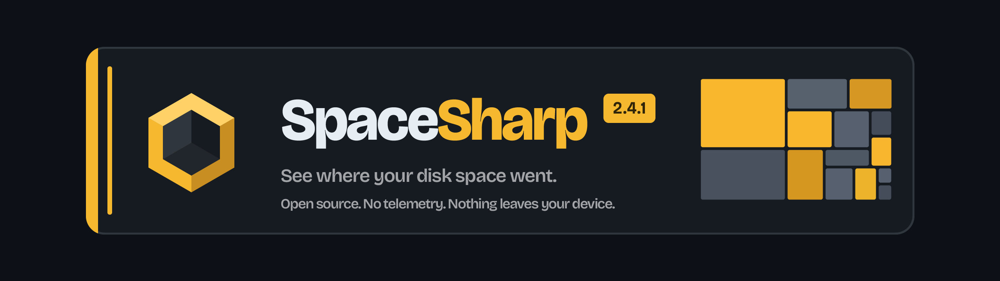
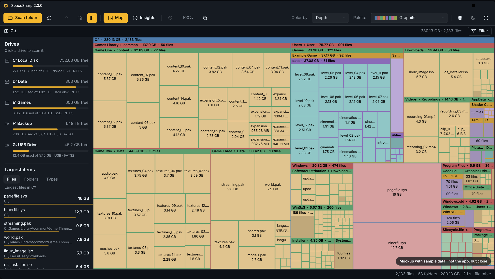
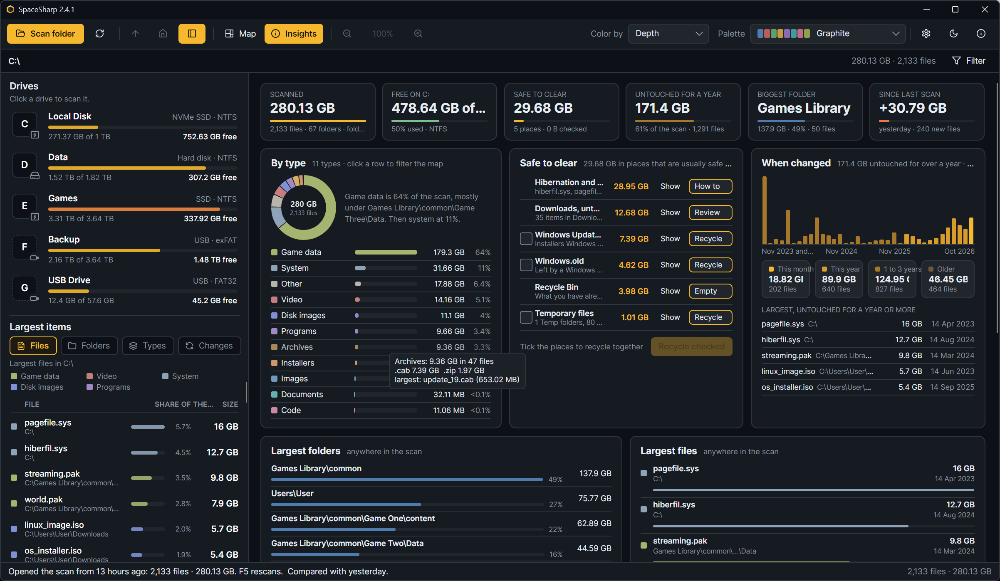
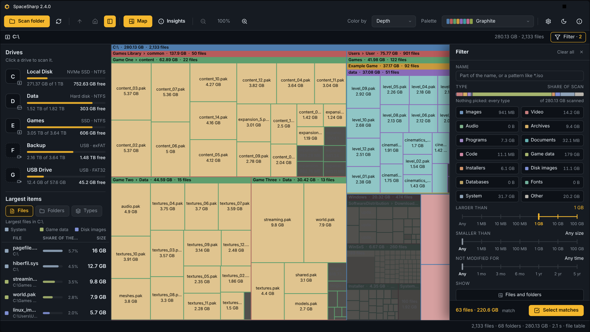
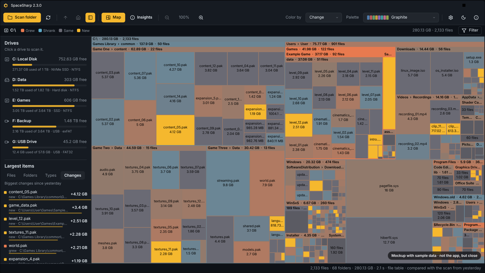
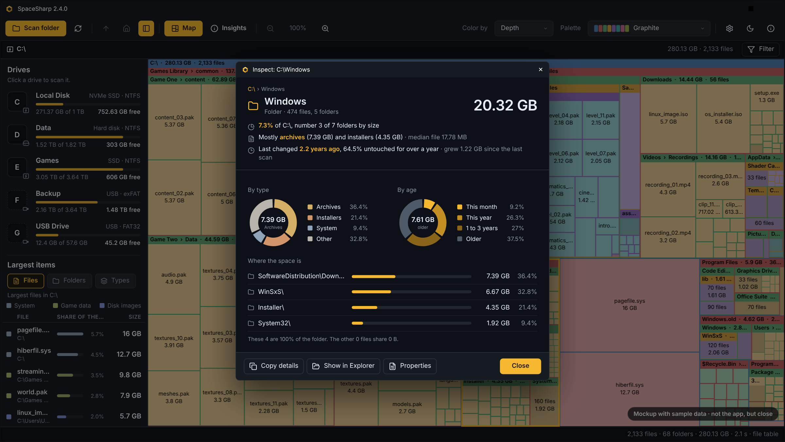
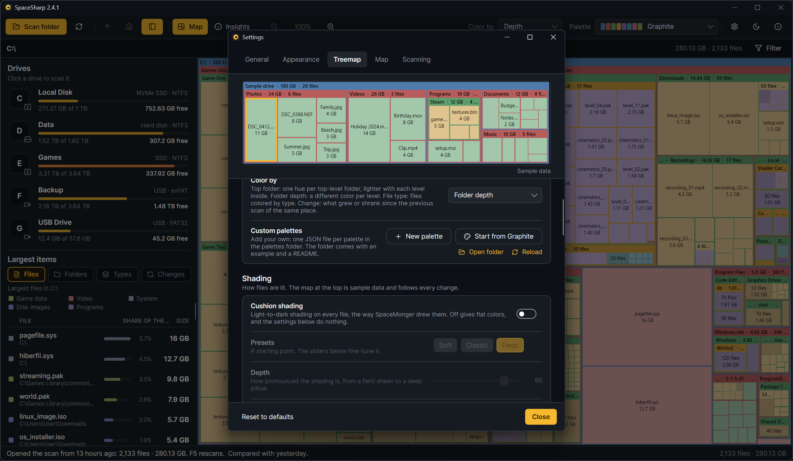
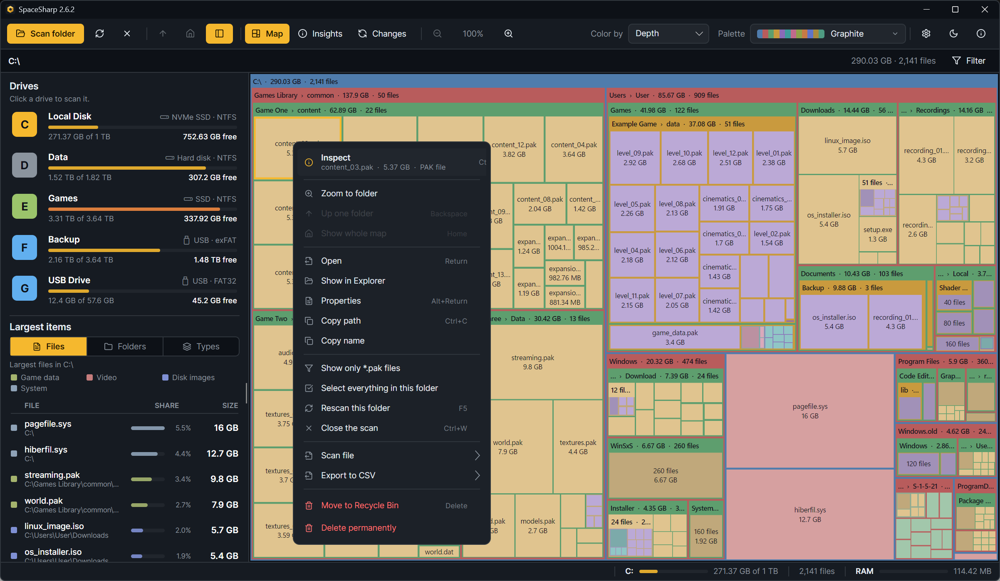

<p align="center">
  
</p>

<p align="center">
  <b>See where your disk space went.</b><br>
  A fast, zoomable treemap of your drives, in the spirit of <a href="https://www.stardock.com/products/spacemonger/">SpaceMonger</a>.
</p>

<p align="center">
  <a href="https://github.com/SpaceSharpApp/SpaceSharp/releases/latest"></a>
  <a href="https://github.com/SpaceSharpApp/SpaceSharp/actions/workflows/tests.yml"></a>
  <a href="LICENSE"></a>
  
  
  
</p>

<p align="center">
  <a href="https://github.com/SpaceSharpApp/SpaceSharp/releases/latest/download/SpaceSharp-win-x64.exe"></a>
  <a href="https://spacesharp.app/"></a>
</p>

<p align="center">
  
  <br>
  <sub>Every file and folder is a box sized by the space it uses. Sample data.</sub>
</p>

Scan a drive, and the whole thing fills the window: folders are frames with a title bar, files are boxes inside them, and the biggest boxes are where your space went. Zoom into any folder, filter in plain words, see what changed since last time, and send what you do not need to the Recycle Bin without leaving the map.

One portable `.exe`, or an installer that updates itself. Free and open source, and code-signed. Since 2.3 SpaceSharp is one app for Windows, macOS and Linux, built on [Avalonia](https://avaloniaui.net); the Mac and Linux packages follow in a later release.

## What it does

| | |
|---|---|
| **Scans a whole drive in seconds** | Reads the NTFS file table directly (asks for administrator rights once); a parallel folder walk covers everything else. Hidden and system files included, junctions skipped. |
| **One map, shaded your way** | Folders are frames, files are cushioned boxes. Shading depth, light direction, title bars, text colors and grid are sliders in Settings with a live preview. |
| **Filter in plain words** | `videos over 500MB older than 1 year` dims everything else and keeps the layout, so you see where the matches are. A drawer with checkboxes and sliders writes the same filter for you. |
| **Insights view** | One click swaps the map for the numbers: what is scanned, free and safe to clear; space by file type with its biggest extensions; places that are usually safe to empty (Windows.old, caches, the Recycle Bin, old Downloads) with a checkbox per row and one Recycle button; a histogram of when files were last changed with the oldest big files; the largest folders and files; what grew, shrank and appeared since last scan; and the biggest extensions and where they live. Every row is a click back to the map, filtered to it. |
| **Remembers every scan** | Opens with yesterday's map on screen. Color by change shows what grew, shrank or appeared since last time. |
| **Inspect anything** | Size and share, where the space is inside, donuts by type and by age, and a callout when one thing holds most of a folder. |
| **Thirteen palettes, twelve looks, and your own** | Seven palettes for the dark theme, six for the light one, twelve hues each, and six looks per theme for the window itself (Graphite, Slate, Mocha, Midnight, Carbon, GitHub Dark; Paper, Linen, Mist, Sand, Snow, GitHub Light). A palette creator makes new ones: generate twelve hues from a base color or set each one by hex or sliders, see them on a sample map as you go, and save. |
| **Cleans up safely** | Everything goes to the Recycle Bin and the map updates without a rescan. |

<table align="center">
  <tr>
    <td align="center" width="50%"><a href="docs/shot-insights.png"></a><br><sub><b>Insights.</b> The map swapped for the numbers, every row a click back to it.</sub></td>
    <td align="center" width="50%"><a href="docs/shot-filter.png"></a><br><sub><b>Filter.</b> Check types, set size and age, and the map dims to the matches.</sub></td>
  </tr>
  <tr>
    <td align="center"><a href="docs/shot-change.png"></a><br><sub><b>What changed.</b> Grew warm, shrank cool, new in amber.</sub></td>
    <td align="center"><a href="docs/shot-inspect.png"></a><br><sub><b>Inspect.</b> Where the space is, by type and by age.</sub></td>
  </tr>
  <tr>
    <td align="center"><a href="docs/shot-settings.png"></a><br><sub><b>Shading.</b> Every slider shows in the preview as you drag it.</sub></td>
    <td align="center"><a href="docs/shot-menu.png"></a><br><sub><b>Right-click.</b> Inspect, open, filter to this type, or send it to the Recycle Bin.</sub></td>
  </tr>
</table>

## Download

For 64-bit Windows 10 and 11 (Windows on ARM runs them through x64 emulation). Get them from the [latest release](https://github.com/SpaceSharpApp/SpaceSharp/releases/latest).

| File | Best for |
|---|---|
| **SpaceSharp-win-x64.exe** | One portable file. Nothing to install; you download new versions yourself. |
| **SpaceSharp-win-x64-Setup.exe** | One-click install to your profile, no admin rights, updates itself. `--installto "D:\Apps\SpaceSharp"` picks another folder. |
| **SpaceSharp-win-x64.msi** | A regular installer where you choose the folder and whether it is for you or everyone. Updates itself. |

32-bit Windows gets the same three with **x86** in the name: **SpaceSharp-win-x86.exe**, **SpaceSharp-win-x86-Setup.exe** and **SpaceSharp-win-x86.msi**. They update from their own channel, so an x86 install never pulls an x64 package. A 32-bit process has less memory to work with, so a drive with several million files is better scanned with the x64 build.

> [!NOTE]
> Every download is code-signed, so Windows shows a verified publisher. SmartScreen may still show "Windows protected your PC" while a new certificate earns its reputation; click **More info**, then **Run anyway**.
>
> SpaceSharp collects no data. The only network requests it makes are the update check and What's new, which read the public release list on GitHub; the portable exe makes neither, and the check can be switched off in Settings.

## Using it

1. Click a drive in the **Drives** list, or **Scan folder** for one folder. Windows asks for administrator rights for a drive scan; without them, protected folders are skipped and marked.
2. The biggest boxes are the biggest space users. Hover for the path and size, double-click a folder to zoom in, Backspace or the mouse back button to go up.
3. Right-click a box for Inspect, Open, Show in Explorer, Properties, copy, filter to its type, select its folder, or Recycle Bin.
4. Press **B** to switch between the map and Insights, **Ctrl+F** for the filter, **L** for the side panel with your drives and the largest files, and the gear or **Ctrl+,** for Settings.

### The filter

The drawer (Ctrl+F) has file types as rows with a share bar, size and age controls, Files or Folders, and presets such as Large files and Untouched for 2 years. Its name box also takes the full syntax, and anything you type becomes checked rows and set controls. Settings › Map › Filter layout switches to a one-row rail of dropdown pills instead.

| You can type | Meaning |
|---|---|
| `*.mp4 *.mkv`, `.iso`, `report` | Name patterns (OR-ed), an extension, or text the name contains |
| `videos`, `photos`, `music`, `archives`, `programs`, `documents`, `code`, `type:video,audio` | File type |
| `>1GB`, `over 500 MB`, `at least 100MB` | Minimum size (a bare number means MB) |
| `<10MB`, `under 1 GB` | Maximum size |
| `older than 2 years`, `not modified in 6 months`, `unused for 1 year` | Not changed for that long |
| `newer than 30 days`, `last 2 months` | Changed recently |
| `files`, `folders`, `is:file`, `is:folder` | Only files or only folders |

Terms combine. **Select matches** (Ctrl+A) selects all of them; Del sends them to the Recycle Bin in one go.

### Settings

Everything applies at once and is saved. The pages:

- **General**: language, update check, confirm before the Recycle Bin, "Scan with SpaceSharp" in Explorer's right-click menu, and the command-line options.
- **Appearance**: theme (match the system, light, dark) and the look: six for each theme, the GitHub Dark and GitHub Light ones drawn in GitHub's own grays.
- **Treemap**: a preview map of sample data pinned at the top, then Colors (palette per theme, Color by, custom palettes), Shading (cushion on or off, presets, Depth, Spread, Tone, Fade, Light from), Text and title bars (label size, font, folder and file text colors, outlined labels, title bar padding and tint), Grid and highlight, and Layout (density, bias, padding).
- **Map**: size measure (file size or size on disk), free space, merge single-folder chains, hover details, filter layout, side panel, animated zoom.
- **Scanning**: fast NTFS scan, names to leave out, reopen the last scan, how long saved scans are kept, hidden and system files, hard links counted once.

**Color by** is Top folder (one hue per top-level folder, lighter at each level), Depth (one color per level, like SpaceMonger), File type (with a legend), or Change (since the last scan). **Palettes**, dark: Graphite, Ocean, Sunset, Forest, Aurora, Monochrome, Color-blind safe; light: Pastel, Paper, Candy, Nordic, Earth, Retro, Color-blind safe (light). Your own come from Settings › Treemap › Custom palettes › New palette (or Start from the current one): a window with the twelve folder colors, the file tint and the fourteen type colors as swatches, each set by hex or hue, saturation and lightness sliders, with the sample map beside them and checks for labels that would be hard to read and folders too alike. It saves a JSON file in `%LocalAppData%\SpaceSharp\palettes`, where hand-written ones go too; Open folder writes an example and a README there.

```json
{ "name": "Mine", "theme": "dark", "folders": ["#5B8DEF", "#49B86B", "#E8C547", "#E8864A"] }
```

### Command line

| | |
|---|---|
| `SpaceSharp.exe D:\` | Scan a drive or folder right away |
| `SpaceSharp.exe scan.sscan` | Open a saved scan |
| `SpaceSharp.exe --compare old.sscan D:\` | Scan `D:\` and compare it with a saved scan |
| `SpaceSharp.exe --help` | All options |

Only one SpaceSharp runs at a time; starting it again hands the request to the open window.

### Keyboard and mouse

| Input | Action |
|---|---|
| Double-click, Enter | Zoom to a folder |
| Mouse wheel, `+` / `−` | Zoom in or out |
| Left or middle drag | Pan |
| Backspace, mouse back button | Up one folder |
| Home, Ctrl+0 | Whole map |
| F5 | Rescan |
| Ctrl+F | Filter |
| Ctrl+A | Select every file matching the filter |
| Del | Move the selection to the Recycle Bin |
| Ctrl+I | Inspect |
| Ctrl+C | Copy the selected paths |
| Ctrl+S, Ctrl+O | Save or open a scan file |
| Alt+Enter | Windows Properties |
| Ctrl+click, Shift+click | Select several |
| K | Next color mode |
| B | Map or Insights |
| L | Side panel |
| G | Density: Everything (no grouping) and back |
| Ctrl+, | Settings |
| Esc | Cancel a scan, close the filter |
| F1 | About and shortcuts |

### Where things are stored

| What | Where |
|---|---|
| Settings | `%AppData%\SpaceSharp\settings.json` |
| Saved scans | `%LocalAppData%\SpaceSharp\scans\*.sscan` |
| Custom palettes | `%LocalAppData%\SpaceSharp\palettes\*.json` |
| The installed app | `%LocalAppData%\SpaceSharp\` |

Nothing leaves the machine except the update check against GitHub Releases, which only installed copies make.

## Building

The [.NET 10 SDK](https://dotnet.microsoft.com/download) on Windows, macOS or Linux. Open `SpaceSharp.sln` in Rider or Visual Studio, or:

```powershell
dotnet run --project .\SpaceSharp\SpaceSharp.csproj
dotnet test
```

The app is `SpaceSharp` (Avalonia, drawn with Skia) on top of `SpaceSharp.Core` (plain .NET: the tree, the layout, scanning, scan files, strings, settings, looks). The NuGet dependencies are Avalonia and Velopack, for the installer and updates. `SpaceSharp.Tests` covers what does not need a screen: layout and grouping, the filter parser, the panel's numbers, formatting, and the tree operations behind delete and free space. Every push runs them on GitHub Actions, on Windows, Linux and macOS; that is all the Actions do. A release is built on the developer's PC, where the code-signing certificate is: `installer\release.ps1 -Sign <thumbprint> -Upload` runs the tests, publishes the builds, packs the installers and MSIs, signs every file, checks the signatures and creates the GitHub release as a draft, which is read and published by hand; the version tag is pushed afterwards. `installer\release.ps1` without `-Upload` is the same build for your own PC, when you want files to try on another machine. The Mac and Linux packages are not built yet. Portable, Portable-x86 and Small (needs the .NET Desktop Runtime) exes come from the publish profiles in `SpaceSharp/Properties/PublishProfiles`; the script builds the x64 and x86 channels side by side (`-NoX86` skips the second).

How the scanner, layout, renderer, filter and updater work, and where to add a palette, a file type or a translation, is in [DEVELOPING.md](DEVELOPING.md).

## Known limitations

- The macOS and Linux packages are not published yet; the app builds and runs there from source.
- Size on disk is an estimate for files stored inside the MFT and leaves out alternate data streams.
- Hard links count once per name unless "Count hard links once" is on, so `WinSxS` can look bigger than it is.
- Junctions and symbolic links are not followed; the target counts where it lives.
- Online-only cloud files show their full size in file-size mode; size on disk shows the local footprint.

## Feedback

[Report a bug](https://github.com/SpaceSharpApp/SpaceSharp/issues/new?template=bug_report.yml) (About › Report a bug fills in your version and Windows details; after an unexpected error, the dialog's Report on GitHub does the same with the error, and the log it points to is in `%LocalAppData%\SpaceSharp\logs`), [suggest a feature](https://github.com/SpaceSharpApp/SpaceSharp/issues/new?template=feature_request.yml), or open a [blank issue](https://github.com/SpaceSharpApp/SpaceSharp/issues/new). Code, palettes and translations: [CONTRIBUTING.md](CONTRIBUTING.md). Screen readers, keyboard and low vision: [ACCESSIBILITY.md](ACCESSIBILITY.md). Releases: [CHANGELOG.md](CHANGELOG.md).

## Credits and license

Squarified treemaps by Bruls, Huizing and van Wijk (2000). Inspired by [SpaceMonger](https://www.stardock.com/products/spacemonger/). Built with [Avalonia UI](https://avaloniaui.net) and [SkiaSharp](https://github.com/mono/SkiaSharp) on .NET 10, in the [Inter](https://rsms.me/inter/) typeface, with [Velopack](https://velopack.io) for the installer and updates. Interface icons are [Lucide](https://lucide.dev). The color-blind safe palette is Okabe and Ito's. Licenses for all of it are in [THIRD-PARTY.md](THIRD-PARTY.md), and About › Credits in the app says the same.

[MIT License](LICENSE). Made by ClearanceClarence.
