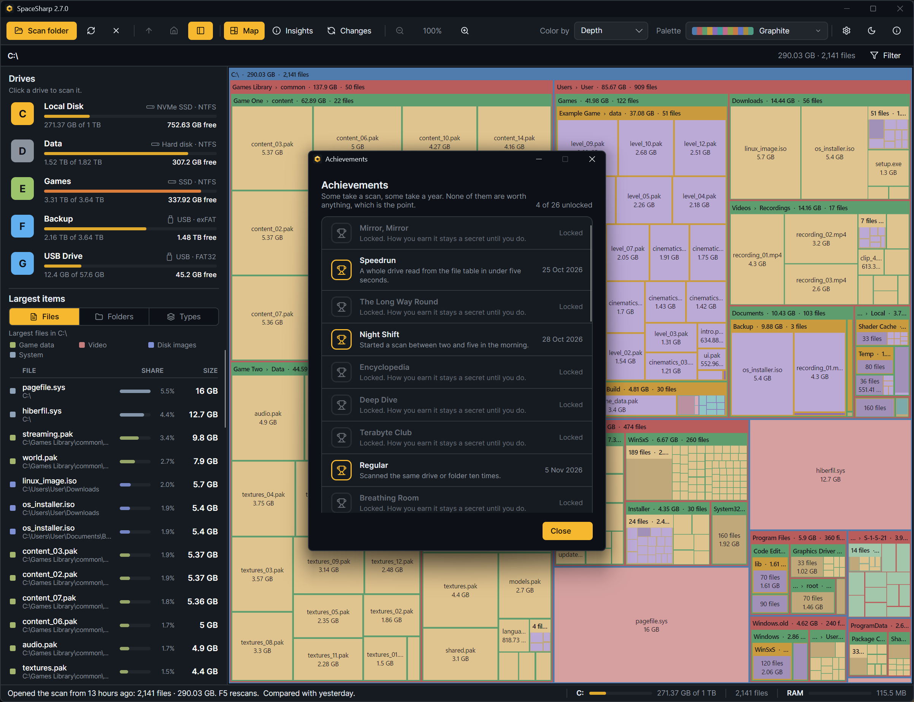
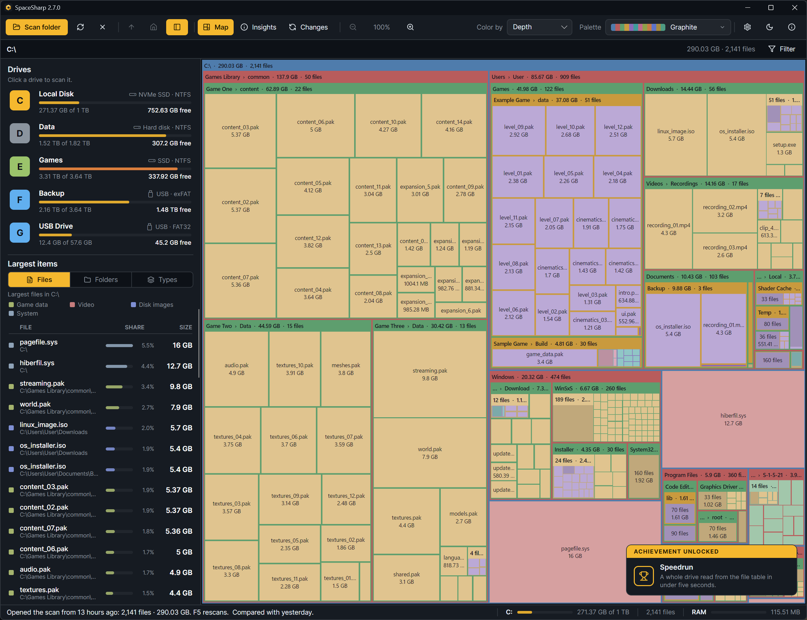

SpaceSharp has achievements, twenty-six of them, since 2.6 (five came with 2.7). They change nothing about how the app works; they are there for the people who notice that their drive was read in four seconds, or that they have a file nobody has touched since 2014.

## Where they show up

- **A toast** in the corner of the map announces a new one for seven seconds, with its name and what earned it.
- **About › Achievements**, or the **T** key, lists them all: the ones you have, with their hint, and the ones you do not, with only their name. Click a locked row to peek at its hint; click again to hide it.
- **Collector**, the last one, opens a small window instead of a toast, and unlocks the **Gold** theme in Settings › Appearance ([Palettes and looks](Palettes-and-Looks#looks)).

## The list

The names are not a secret; the hints are, until you earn them or peek. A few, for flavor:

| Name | Earned by |
|---|---|
| Speedrun | A whole drive read from the file table in under five seconds |
| The Long Way Round | Walking a whole drive folder by folder with the file table right there |
| Terabyte Club | Scanning a drive of a terabyte or more |
| Full House | Scanning a drive with 1% or less free |
| Mirror, Mirror | Comparing a scan with its own save |
| Collector | Every other achievement |

The rest: Night Shift, Encyclopedia, Deep Dive, Regular, Breathing Room, Spring Cleaning, Hoarder, Whale, Hall of Mirrors, Dust, Nothing Happened, Plot Twist, Tourist, Polyglot, Archaeologist, and from 2.7 Twins, Tidy, Second thoughts, Housekeeper and Painter, which belong to the duplicate finder, the empty folder list, the delete questions, Safe to clear and the palette editor.

## Where they are kept

`%LocalAppData%\SpaceSharp\achievements.json`: the unlocked ones with the time each was earned, and the few counters some of them need (scans of the same drive, language changes). Delete the file to start over; there is no reset button on purpose. The pretend PC that the screenshots use (`--mock`) has its own in-memory list with four mild ones unlocked, so pictures spoil nothing and never touch your file.
