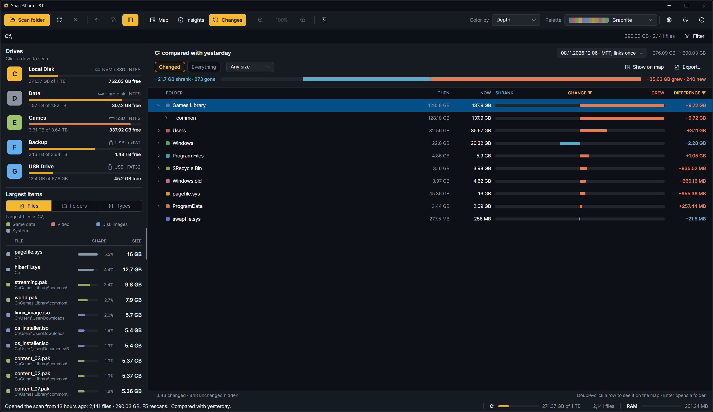
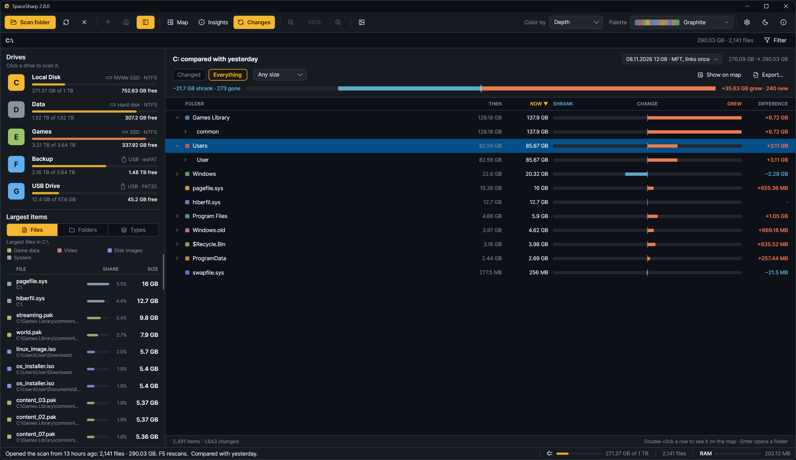

Every scan is saved, and the next scan of the same place is compared with it. **Changes**, the third view next to Map and Insights, lays the two out as a folder table. **B** cycles the views while a scan is compared.

## What the table shows

| Column | Meaning |
|---|---|
| Folder | The name, with a chevron for folders that open in place and a swatch for top-level folders |
| Then | Its size in the compared scan |
| Now | Its size in this scan |
| Shrank · Change · Grew | A bar from a center line: shrank to the left in blue, grew to the right in orange, scaled to the biggest top-level change. New items are amber; gone items are a dashed outline |
| Difference | Now minus then |

Three tags appear in the Folder column: **New** for files and folders that were not in the compared scan, **Gone** for ones that were and are not in this one, listed with the size they used to take, and **Not visible to this method** for the few root items only one scan method can see (`$MFT`, `$LogFile` and the other NTFS metafiles, `System Volume Information`) when a file-table scan is compared with a folder walk. Those are not a change, show no difference and stay out of the totals. That is why a folder's difference and its rows always add up.

## The header

- **"C: compared with 13 hours ago"**, and under it a picker with the compared scan's time and method. The picker switches to the previous autosave of the drive, to any saved scan (Compare with a saved scan…), or to none (Stop comparing).
- The scanned bytes **then → now**.
- One diverging bar for the totals: **−7.4 GB shrank · 1,180 gone** on the left, **+21.6 GB grew · 3,412 new** on the right.

## Filters and sorting

- **Changed** (the default) shows only rows whose size changed plus what is new or gone. **Everything** shows every row.
- **Any size / Over 1 MB / 10 MB / 100 MB / 1 GB** hides changes smaller than that.
- Click a column header to sort by it (change, name, then or now); click again to flip the order.

## Moving around

- A folder opens in place with its chevron, **Enter**, or the **Right** arrow; **Left** closes it or goes to its parent. A folder with more than three hundred changed lines shows them a page at a time, with a "… more" line for the next page.
- **Double-click** a row, or select it and press **Show on map**, to go there on the map.
- **Export…** opens the Export window on the changed files and folders, biggest change first ([Exporting](Exporting)). Gone items have no file to point at and are not in the export.
- The footer counts what changed and how many unchanged rows are hidden.

## How comparisons happen

- After every scan, the previous autosave of the same place becomes the comparison, as long as both scans were made the same way (same scan method, same hidden-file and hard-link settings). The status bar says "compared with the scan from 13 hours ago". If the previous scan was made differently it is skipped, with a note, and the next scan of the same kind is compared.
- **Compare with a saved scan…** (right-click › Scan file, or the empty Changes view) compares the open scan with any `.sscan` file and opens the view. Comparing scans of different roots matches names folder by folder. If the two were made differently, SpaceSharp warns before comparing and the header says so while the comparison is showing, since files only one method can see would look like deletions. Comparing a scan with its own save gets you the Mirror, Mirror [achievement](Achievements) and a request for an earlier scan instead of a change report.
- Items are matched by name within each folder, so a renamed file shows as one gone and one new. A hard-linked file is matched by its real size whichever path carried it, so the two scan methods choosing different primaries does not show as change.
- The tooltip on the map and the **Since last scan** row in Insights use the same comparison.
- Deleting all saved scans in Settings closes the comparison on screen when the scan it compared with was among them.

## Changes replaced the Change color mode

Until 2.4, Color by had a fourth option, Change, that painted the map by growth. The view replaced it in 2.5; a settings file that still says Change falls back to Top folder.
