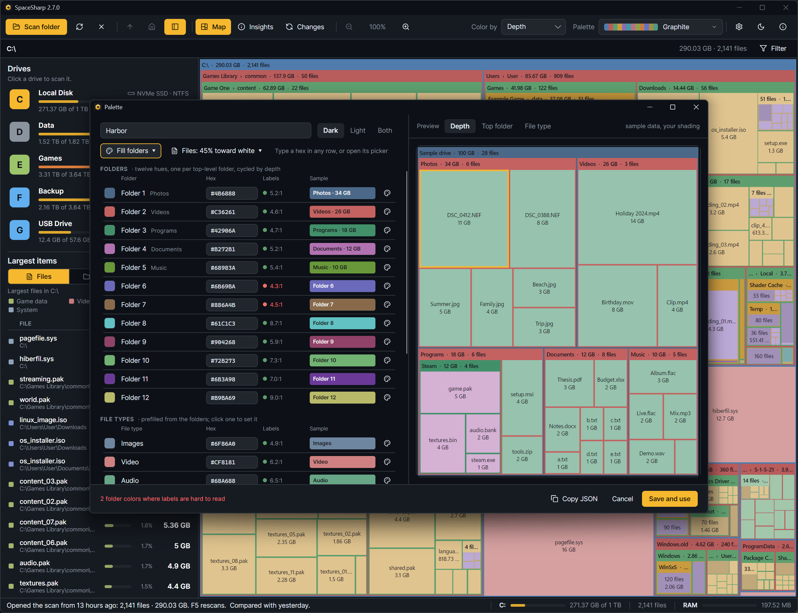

<p align="center"></p>

A custom palette is a JSON file in your palettes folder. The **palette editor** writes one for you; a text editor works too. Either way the palette appears in the picker's Custom tab next to the built-in ones, and the map uses it like any other.

## Opening the editor

- The palette picker in the toolbar: **New palette…** in its corner.
- Settings › Treemap › Custom palettes: **New palette**, or **Edit** under a custom palette you already have, or **Start from…** under any built-in one to begin with its colors.

## What is in it

The window is three lists and a preview.

**Folders.** Twelve rows, one per top-level folder color (and every twelfth level down in Depth mode). Each row has the swatch, the hex you can type into, a sample, and a readability note: which text color labels get on it and the contrast ratio, in red when it falls under 4.5:1. The **Fill folders** menu starts you off from Folder 1's color with a spread: **Rainbow** (twelve hues evenly around the wheel), **Neighbors** (hues close to Folder 1), **Two-tone** (Folder 1 and its opposite, alternating) or **One hue** (shades of Folder 1 only). **Random** picks a base color and a spread; press it until something looks right, then adjust. **Paste 12 hexes** takes the codes on your clipboard in order.

**Files.** By default the folder color lifted toward white by one tint; the slider sets how far. **Set each file color yourself** turns the list into twelve editable rows instead, and **Use one tint instead** goes back.

**File types.** One color per type for Color by file type, prefilled from the folder colors. Click one to set it; a type you set stays set when the folders change, one you did not follows them. **Back to derived** forgets your choice for that type.

**Preview.** A sample map on the right, drawn with your shading settings, in the Color by mode the map is in. It follows every edit.

The header has the palette's **name** (what the picker will call it; built-in names are refused), which theme it is **for** (Dark, Light or Both; decides which tab lists it), and a readability summary: "Labels read on every folder color, and no two are too alike", or which folders are too close to tell apart.

**Save and use** writes the file and switches the map to it. **Copy JSON** puts the file's text on the clipboard instead, for sharing or for a palette you keep somewhere else. Saving over an existing custom palette asks first.

## Opening the picker on a color

Each row's swatch opens a picker: hue, saturation and lightness sliders, the hex, and a strip of suggested shades. Under it the same readability line for that color alone.

## The files

`%LocalAppData%\SpaceSharp\palettes`, one `.json` per palette. **Open folder** in Settings › Treemap › Custom palettes takes you there and writes `Example.json` (commented) and a README the first time. **Reload** picks up files you edited or dropped in without a restart.

```jsonc
{
  "name": "Harbor",
  "theme": "dark",            // "dark", "light" or "any": which tab lists it
  "folders": ["#4F7CAC", "#49B86B", "#E8C547", "#E8864A", "#B565D9", "#4CC3C9", "#E86A8A"],
  "fileTint": 0.45,           // files are the folder colors lifted toward white by this (0 to 0.9) ...
  // "files": [...],          // ... unless you list twelve file colors yourself
  "categories": {             // File type mode; any left out come from the folder colors
    "video": "#E8864A", "images": "#49B86B", "audio": "#B565D9", "archives": "#E8C547",
    "programs": "#5B8DEF", "documents": "#BAC4E2", "code": "#4CC3C9", "gamedata": "#C9A66B",
    "installers": "#D9A066", "diskimages": "#C7C09A", "databases": "#5FA8D3", "fonts": "#B9A0E0",
    "system": "#8FA3B8", "other": "#B8B4AC"
  }
}
```

- One to twelve folder colors, `#RRGGBB`; fewer are cycled to twelve.
- `files`, `fileTint`, `categories` and `theme` are optional. Leave `files` out and `fileTint` applies; leave both out and the tint is 0.45.
- The fourteen type keys are `video`, `images`, `audio`, `archives`, `programs`, `documents`, `code`, `gamedata`, `installers`, `diskimages`, `databases`, `fonts`, `system`, `other`.
- Comments and trailing commas are allowed. A file that cannot be read is listed with its error under Custom palettes rather than skipped silently.
- The palette's line in the picker is its file name.

## Sharing one

Send the `.json`, or the **Copy JSON** text. The other person drops it in their palettes folder and presses Reload. A palette worth having in the app itself can be proposed as a pull request: built-in palettes live in `BuildSchemes()` in `SpaceSharp/Util/Palette.cs` with a one-line description ([Architecture](Architecture#where-to-add-things)).
