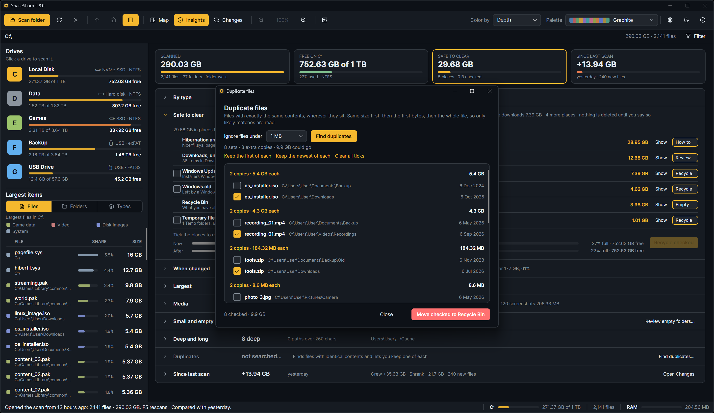
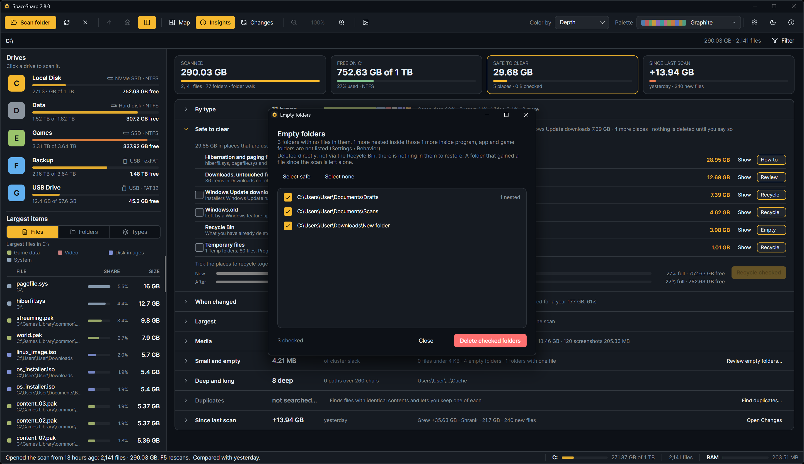

Two rows in [Insights](Insights) open a window of their own: **Duplicates** finds files with identical contents, and **Small and empty** lists the folders with nothing in them. Both work on the scan you have open, both act only on what you tick, and both update the map afterward. Duplicates go to the Recycle Bin; empty folders are deleted directly, since there is nothing in them to restore.

## Duplicates

There are four ways into the finder:

- **Ctrl+D** anywhere in the window.
- The **Duplicates** tile at the top of Insights, or **Find duplicates…** on the Duplicates row under it.
- Right-click a folder on the map, **Find duplicates in this folder**: the search covers that folder alone, and the window says which. Its result does not replace the whole scan's in Insights.
- Right-click a file, **Find copies of this file**: the search runs at once and picks out that file's set.

Pick a minimum size and press **Find duplicates**.

**How it searches.** Files are grouped by size first, since only a size shared by two or more files can hold a duplicate. The files that share a size have three samples hashed: the first, middle and last 16 KB. That splits nearly every group apart, including files that only start alike, such as archives and game data with a common header. Only the files that still match are read in full (SHA-256), and big ones are read side by side a few megabytes at a time: a file is dropped the moment its contents so far match no other, so only true copies are read to the end. On most drives very little is read, and the reads run on several threads at once. Hard links are the same file and are not counted. A file the search cannot read, or whose size is no longer what the scan recorded, is left out of its set; rescan to include it.

**The minimum size.** 64 KB, 1 MB (the default), 10 MB, 100 MB or 1 GB. Tiny files are many and rarely worth the time; raise the limit on a slow drive, lower it when you are hunting small things.

**While it runs.** A progress bar and a line that says which stage it is in (grouping by size, comparing samples, reading whole files), how many files are done and how much has been read. **Cancel** stops it between files.

**The result.** Sets sorted by what deleting the extra copies would free, each with its copies, their folders and ages, and the hash in the tooltip of the size. Nothing is ticked to start with:

- **Keep the first of each** ticks every copy but the first (in path order) of every set.
- **Keep the newest of each** keeps the most recently modified copy.
- Neither ticks a copy inside Windows, Program Files, ProgramData, AppData or a game or build folder. A program that depends on its copy breaks without it, so those are marked **program folder** in red and are only ticked by hand. While any of them is ticked, a warning under the links says how many, the footer counts them, and the confirmation repeats the number.
- **Clear all ticks** starts over.
- Or tick by hand.

**Move checked to Recycle Bin** sends the ticked copies to the Recycle Bin after the usual confirmation. If every copy of a set is ticked, the confirmation says so first, since nothing of that file would be left; if a ticked copy is in a program folder, it says that too. The copies go two hundred at a time with a progress panel in the window and a **Stop** button that ends it between batches, keeping what was already moved. Afterward the list shows what is still duplicated, and the Duplicates row in Insights shows the sets, the extra copies and what could go, until the next scan.

## Empty folders

**Review empty folders…** on the Small and empty row lists every folder in the scan with no files in it at any depth. A folder that only holds other empty folders is listed once, as the topmost one, with the count of empty folders nested inside it; deleting it takes them along. A folder the scan could not read is never listed as empty, since it may hold anything.

Empty folders are **deleted directly, not moved to the Recycle Bin**: there is nothing in them to restore, and the bin would take minutes for thousands of them. The delete is the non-recursive one, so a folder that gained a file since the scan refuses to go and is reported.

Not every empty folder is yours to delete. Windows Store apps keep their state in empty folders under `AppData\Local\Packages`, games keep save folders, installed programs keep folders under `Program Files`, and deleting those breaks the program that owns them. So the list is careful by default:

- Settings › Behavior › **Hide unsafe empty folders** (on by default) leaves those out of the list entirely, and the summary says how many were left out.
- With it off, they are listed unticked. **Select safe** ticks only the folders that are plainly yours (under your own Desktop, Documents, Downloads, Pictures, Music and Videos on the system drive; outside program, game and build folders on other drives), **Select none** clears, and **Select all** is red for a reason. While anything outside the safe set is ticked, a warning under the buttons says how many and what can break, the footer counts them, and the confirmation repeats the number.

Each row has its own tick, **Delete checked folders** asks first and then shows progress with a Stop button, and the list is rebuilt from what is left.

## Notes

- Both windows describe the scan as it was made; a file added since the scan is not in it. F5 rescans.
- Deleting updates the map, the side panel and Insights without a rescan, the same as deleting from the map ([Cleaning up](Cleaning-Up)).
- A duplicate search is not saved with the scan; opening a saved scan starts with the row unsearched.
