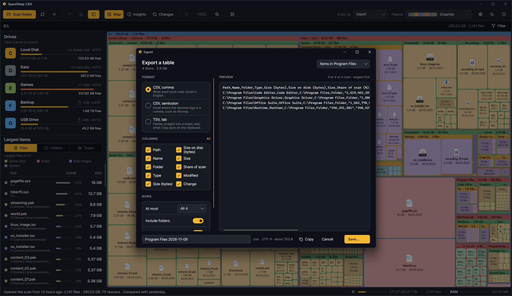

Right-click › More › **Export…** on the map, or **Export…** in the Changes view, opens one window that writes a table of files and folders as CSV or TSV, or puts it on the clipboard.

## What goes in

The picker at the top right chooses the rows:

- **Items in <folder>**: the direct children of the folder you right-clicked (a file's folder for a file).
- **Everything under <folder>**: every file and folder below it.
- **The largest files on the drive**: the top 1,000.
- **The filter's matches**, when a filter is on.
- **What changed since the compared scan**, when one is loaded: biggest change first, at most 5,000 rows.

Rows come largest first. The line under the heading says how many and how much they add up to.

## Format

- **CSV, comma**: what most tools read, and Excel in English.
- **CSV, semicolon**: Excel where the decimal sign is a comma, such as Norway; a comma-separated file opens there as one column.
- **TSV, tab**: pastes straight into a spreadsheet. **Copy** always puts the table on the clipboard as TSV, whatever is picked, since that is what sheets paste as cells.

Files are UTF-8 with a byte-order mark, so Excel reads accented names correctly.

## Columns and rows

Tick the columns you want: Path, Name, Folder, Type, Size (bytes), Size on disk (bytes), Size (as the map writes it), Share of scan (percent, one decimal), Modified (UTC), Change since the compared scan (bytes). The headers in the file are always English, so the same file reads the same everywhere.

Under **Rows**: at most all, 1,000 or 100 rows; **Include folders** off writes files only; **Header row** off starts with the first row; **Bytes with separators** writes 15,562,073,417 instead of 15562073417, which is easier on the eye but stops a spreadsheet from summing the column, so turn it off for numbers you will calculate with.

## Preview

The right side shows the file as it will be written, the first 200 rows with the delimiter and quoting as they will be, then a line saying how many rows follow; it changes with every option. The foot shows the file name (editable), the extension the format gives it, and the size the file will have.

Your choices are kept for next time.
