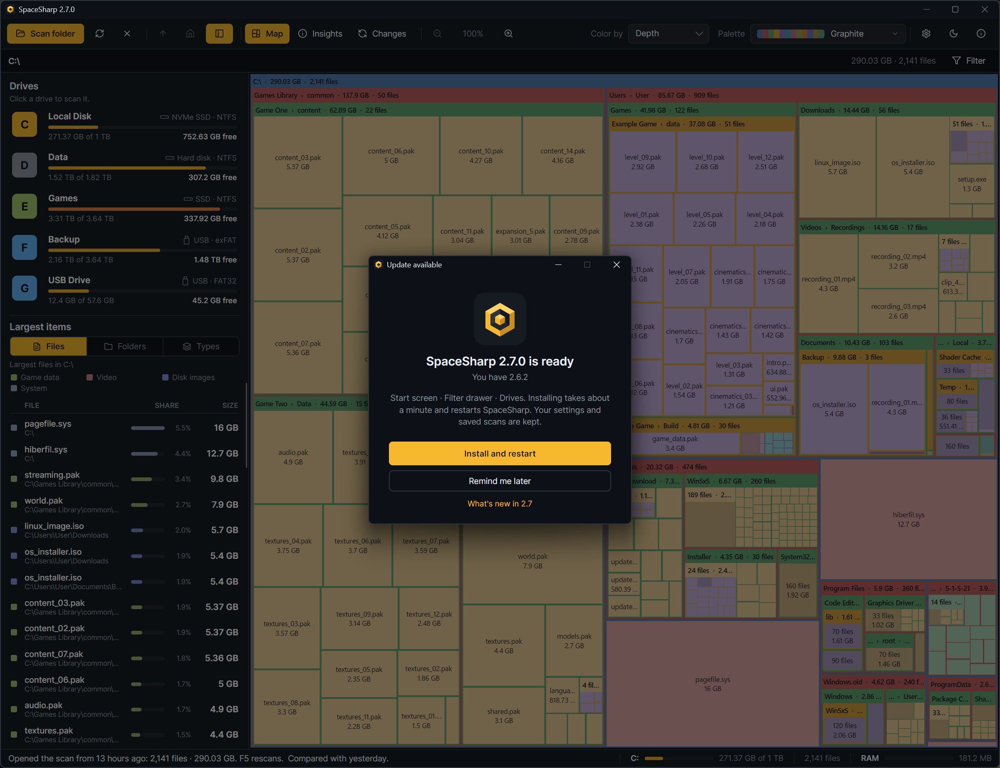

SpaceSharp runs on Windows 10 and 11, 64-bit and 32-bit. The portable exe and both installers carry their own .NET runtime, so there is nothing else to install.

## Choose a download

All of them are on the [latest release](https://github.com/SpaceSharpApp/SpaceSharp/releases/latest). Every file is code-signed.

| File | What it is | Pick it when |
|---|---|---|
| `SpaceSharp-win-x64-Setup.exe` | A one-click installer into your user profile. No administrator rights. Updates itself. | You want the app to stay current on its own. |
| `SpaceSharp-win-x64.msi` | A Windows Installer package. Installs wherever you point it. Updates itself. | You manage PCs, or want the app under Program Files. |
| `SpaceSharp-win-x64.exe` | One portable file. Nothing is installed; settings still go to your profile. Never updates itself. | A USB stick, a quick look at a friend's PC, or you prefer no installer. |
| `SpaceSharp-win-x64-Portable.zip` | The portable layout that does update itself. | You want portable and updates. |
| `SpaceSharp-win-x86-*` | The same four for 32-bit Windows. | Your Windows is 32-bit. Windows on ARM runs the x64 build through emulation. |

`SHA256SUMS.txt` on the release page lists the hash of every file.

**SmartScreen.** A new certificate earns its reputation over time; while it does, Windows may show "Windows protected your PC" the first time. Choose **More info**, then **Run anyway**. The publisher shown in that dialog is what the signature guarantees.

## The first scan

The start screen lists your drives on the left with how full each is, and the first time it says where your scan will go and what a scan is. Click a drive.

For an NTFS drive, SpaceSharp asks for **administrator permission** through the normal Windows prompt. That is for the fast scan: reading the drive's file table means opening the drive itself rather than its folders, and Windows only lets administrators do that. A separate helper process reads the table, hands the result back, and exits; the window you use never runs elevated. A million files take a few seconds this way.

Say **No** and nothing breaks: SpaceSharp walks the folders instead, which takes longer, and the map draws itself as it goes. Folders, external drives and non-NTFS drives always use the walk.

While a scan runs, a small card in the map's corner shows the stage, the file count, the current path and a clock (in hundredths of a second for the first ten seconds, since the file-table scan is often done by then). **Esc** cancels.

## What you see afterwards

The map, with the path row above it and the side panel on the left. Big boxes are where the space is. [Reading the map](Reading-the-Map) explains what everything means; [Navigating](Navigating) covers zoom and the panels.

The scan is saved automatically, so next time the start screen offers it with one click and the scan after that is compared with it. [Saved scans and the start screen](Saved-Scans-and-the-Start-Screen) has the details.

## Updating

Installed copies check GitHub for a new release a few seconds after they start (Settings › Behavior › Check for updates on startup) and offer **Install and restart**. The portable exe does not update itself; download the new one. The update prompt shows the changelog for every version you skipped.
