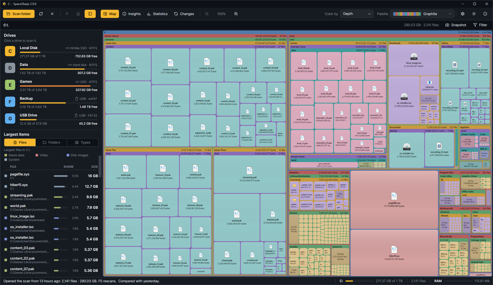

**SpaceSharp** is a free, open source disk space analyzer. It scans a drive or a folder and draws it as a zoomable treemap: folders are frames, files are boxes sized by the space they take. These pages are the long version of the [README](https://github.com/SpaceSharpApp/SpaceSharp#readme): every screen, every setting, every shortcut, and the answers to the questions that come up.

**[Download the latest release](https://github.com/SpaceSharpApp/SpaceSharp/releases/latest)** · [Website](https://spacesharp.app/) · [Changelog](https://github.com/SpaceSharpApp/SpaceSharp/blob/main/CHANGELOG.md) · [Report a bug](https://github.com/SpaceSharpApp/SpaceSharp/issues/new/choose)

## Using SpaceSharp

- [Getting started](Getting-Started): install, the first scan, the administrator prompt
- [Reading the map](Reading-the-Map): what the frames, boxes, colors and shading mean
- [Navigating](Navigating): zoom, pan, the path row, the side panel
- [The filter](The-Filter): plain words, the drawer, quick filters, Select matches
- [Insights](Insights): the numbers behind the map, row by row, and Safe to clear
- [Statistics](Statistics): the scan as a report: files by size, kind and age, the biggest extensions, the largest files and folders
- [Duplicates and empty folders](Duplicates-and-Empty-Folders): files kept twice, folders with nothing in them
- [Changes](Changes): what grew, shrank, appeared and disappeared since the last scan
- [Inspect](Inspect): one item in depth
- [Cleaning up](Cleaning-Up): the Recycle Bin rule, and deleting what Explorer cannot
- [Saved scans and the start screen](Saved-Scans-and-the-Start-Screen)
- [Settings reference](Settings-Reference): every setting, one line each
- [Palettes and looks](Palettes-and-Looks): the 24 palettes, the picker, themes and looks
- [Custom palettes](Custom-Palettes): the palette editor and the JSON format
- [Keyboard shortcuts](Keyboard-Shortcuts)
- [Command line](Command-Line)
- [Languages](Languages)
- [Achievements](Achievements)

## Questions and problems

- [FAQ](FAQ)
- [Troubleshooting](Troubleshooting)
- [Privacy and security](Privacy-and-Security)
- [Suggest a correction](Suggest-a-Correction): found a mistake on these pages

## For contributors

- [Building from source](Building-from-Source)
- [Architecture](Architecture)
- [Translating](Translating)

## New in 2.9

- **A Statistics view**: the scan as a report, SpaceMonger style and then some: files by size class stacked by kind, kinds, ages, the biggest extensions, and the space that is easy to get back, every figure a click back to the map, with deltas against the compared scan ([Statistics](Statistics)).
- **The palette editor rebuilt** around a few decisions: hue, saturation, lightness, a scheme, a step per level and how files are tinted, with a readability guard that fixes itself, Random, From a picture and Start from any palette; the preview is live and clickable, and the color-by-color grids live under Advanced ([Custom palettes](Custom-Palettes)).
- **The map**: title bars with the name left and the facts right, Uniform as the default, live loading that keeps up with the walk, the folder in the window title, slim scrollbars, and a theme button that shows what a click gives you.

## New in 2.8

- **A Modern map style**, now the default: rounded boxes with a gap around each, Windows' icon for each kind of file, labels that shrink with the box and add the size and date when there is room. Classic, the map as it was, is one setting or the **M** key away ([Reading the map](Reading-the-Map#two-styles)).
- **A Uniform map** beside the Physical one: folders keep their share, every file in a folder is drawn the same size (**U**) ([Reading the map](Reading-the-Map#physical-or-uniform)).
- **Export** is a window: pick the rows, CSV or TSV, the columns, a row limit, and see the file before you save it, or copy it straight to a spreadsheet ([Exporting](Exporting)).
- **The right-click menu redone**: the item's facts and its share up top, only the rows that apply, the long tail under More, and new rows for selecting all files of a type, finding copies of a file, opening Changes at a folder and leaving a folder out of future scans ([Navigating](Navigating#the-right-click-menu)).
- **Free space** as a quiet panel with a ring for the free share (**G** shows or hides it), sizes as exact bytes, a date toggle, and a Snapshot button that saves the map as a picture ([Navigating](Navigating#saving-the-map-as-a-picture)).
- Settings › Treemap sorted by style, the shortcuts window regrouped, a crash in the autosave fixed, and a Recycle Bin report that names the file in use instead of calling a folder too long.

Earlier releases are in the [changelog](https://github.com/SpaceSharpApp/SpaceSharp/blob/main/CHANGELOG.md).
