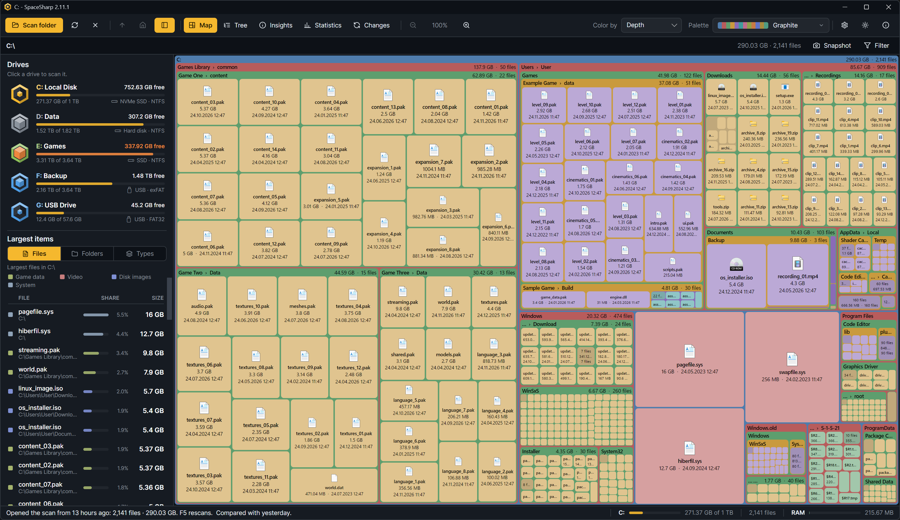

**SpaceSharp** is a free, open source disk space analyzer. It scans a drive or a folder and draws it as a zoomable treemap: folders are frames, files are boxes sized by the space they take. These pages are the long version of the [README](https://github.com/SpaceSharpApp/SpaceSharp#readme): every screen, every setting, every shortcut, and the answers to the questions that come up.

**[Download the latest release](https://github.com/SpaceSharpApp/SpaceSharp/releases/latest)** · [Website](https://spacesharp.app/) · [Changelog](https://github.com/SpaceSharpApp/SpaceSharp/blob/main/CHANGELOG.md) · [Report a bug](https://github.com/SpaceSharpApp/SpaceSharp/issues/new/choose)

## Using SpaceSharp

- [Getting started](Getting-Started): install, the first scan, the administrator prompt
- [Reading the map](Reading-the-Map): what the frames, boxes, colors and shading mean
- [Navigating](Navigating): zoom, pan, the path row, the side panel
- [The filter](The-Filter): plain words, the drawer, quick filters, Select matches
- [Insights](Insights): the numbers behind the map, row by row, and Safe to clear
- [Statistics](Statistics): the scan as a report: files by size, kind and age, the biggest extensions, the largest files and folders
- [Duplicates and empty folders](Duplicates-and-Empty-Folders): files kept twice, folders with nothing in them
- [Changes](Changes): what grew, shrank, appeared and disappeared since the last scan
- [Inspect](Inspect): one item in depth
- [Cleaning up](Cleaning-Up): the Recycle Bin rule, and deleting what Explorer cannot
- [Saved scans and the start screen](Saved-Scans-and-the-Start-Screen)
- [Settings reference](Settings-Reference): every setting, one line each
- [Palettes and looks](Palettes-and-Looks): the 24 palettes, the picker, themes and looks
- [Custom palettes](Custom-Palettes): the palette editor and the JSON format
- [Keyboard shortcuts](Keyboard-Shortcuts)
- [Command line](Command-Line)
- [Languages](Languages)
- [Achievements](Achievements)

## Questions and problems

- [FAQ](FAQ)
- [Troubleshooting](Troubleshooting)
- [Privacy and security](Privacy-and-Security)
- [Suggest a correction](Suggest-a-Correction): found a mistake on these pages

## For contributors

- [Building from source](Building-from-Source)
- [Architecture](Architecture)
- [Translating](Translating)

## New in the latest release

- **A scanning card you can move**: drag it to any corner of the map and it stays there ([Getting started](Getting-Started)).
- **Saved scans you can delete one at a time**, from the start screen ([Saved scans and the start screen](Saved-Scans-and-the-Start-Screen)).
- **Export, Duplicates and Empty folders laid out again**: a table preview in Export, sets on the left and copies on the right in Duplicates, and empty folders grouped under the folder they sit in ([Exporting](Exporting), [Duplicates and empty folders](Duplicates-and-Empty-Folders)).
- **A deeper minimap**: up to three levels of folders, with or without names ([Navigating](Navigating#the-minimap)).
- **Drive tiles in the shape of the SpaceSharp cube**, in the color of the drive's kind, in the side panel and on the start screen.

Every release is in the [changelog](https://github.com/SpaceSharpApp/SpaceSharp/blob/main/CHANGELOG.md).
