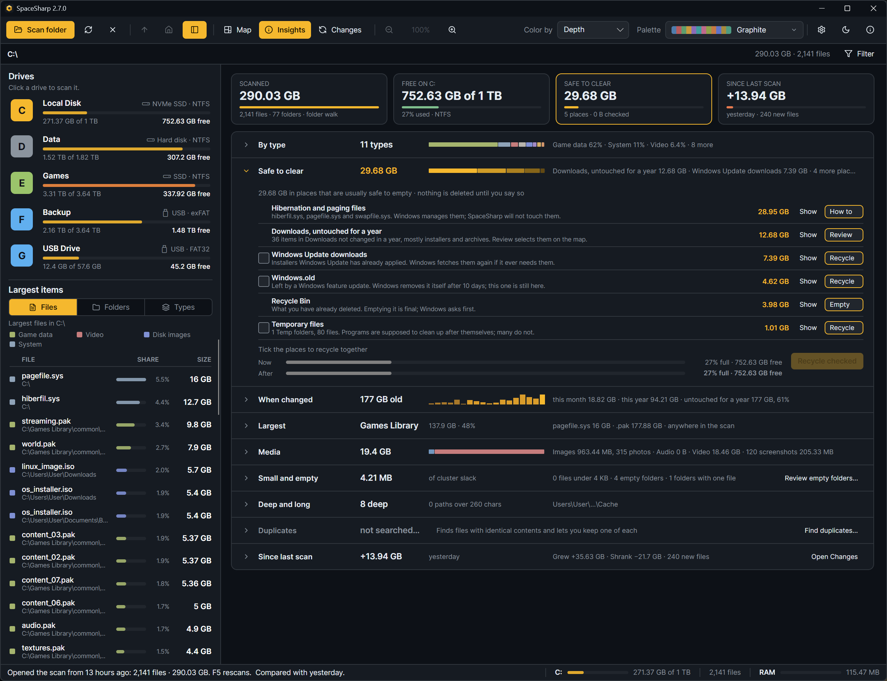

**Insights** swaps the map for the numbers behind it. The Insights button in the toolbar opens it; **B** cycles Map, Insights and Changes. Since 2.6 it is four tiles over a single column of rows that open one at a time, so the page can be read without opening anything, and every row is a click back to the map, zoomed or filtered to what the row was about.

## The tiles at the top

| Tile | What it says |
|---|---|
| **Scanned** | Files, folders and bytes, and whether the scan came from the file table or a folder walk |
| **Free** | How full the drive is and what is free; for a folder scan, the drive the folder is on |
| **Safe to clear** | What the places in the Safe to clear row add up to |
| **Untouched** | How much of the scan has not changed in a year. Once a scan is compared, this tile becomes **Since last scan**: the net change against the compared scan |

## The rows

Every closed row shows the same four things: its name, one number, a small bar or sparkline, and three short facts. Click a row to open it; the row that was open closes. The open row is remembered between runs. A row with nothing to show (no games, no hard links, no long paths) is left out.

**By type.** Space by file type (video, images, archives, game data, installers and so on), a stacked bar of the shares, and inside the row the biggest extensions of each type. Click a type to filter the map to it.

**Safe to clear.** Places that are usually fine to empty, found by name only, largest first:

| Place | What is matched | Button |
|---|---|---|
| Windows.old | The folder a feature update leaves behind | Recycle |
| Recycle Bin | `$Recycle.Bin` | Empty (Windows asks first) |
| Hibernation and paging files | `hiberfil.sys`, `pagefile.sys`, `swapfile.sys` | How to (SpaceSharp never touches them) |
| Temporary files | `AppData\Local\Temp`, `Windows\Temp` | Recycle |
| Package caches | npm, pnpm, Yarn, NuGet, pip, Cargo, Gradle, Composer, Go, Maven caches | Recycle |
| Browser caches | Chrome, Edge, Firefox, Brave page caches and INetCache; passwords, history and tabs are not in them | Recycle |
| Shader caches | Steam, NVIDIA, AMD and DirectX shader caches; rebuilt on the next launch | Recycle |
| Windows Update downloads | `Windows\SoftwareDistribution\Download` | Recycle |
| Downloads, untouched for a year | Items in any user's Downloads not changed in a year | Review (selects them on the map) |

Tick the rows you want gone and press **Recycle checked**; everything goes to the Recycle Bin after the usual confirmation. **Show** selects a row's places on the map and flashes them three times so you can find them, then leaves them selected so you can look first. Under the list, two bars show the drive **now** and **after**: the amber slice of the top bar is what the ticked places take up today, the lower bar is the drive without them. Tick and untick, and the bars follow.

**When changed.** A sparkline of last-modified dates by month, with bands for this month, this year, one to three years and older. Click a month or a band to filter the map to it.

**Largest.** One row with a switch: **Files**, **Folders** or **Extensions**, the top of each with their share of the scan. Click to zoom there.

**Games.** Steam, Ubisoft, Epic, GOG, Xbox, EA and Riot libraries with their game counts and the biggest games.

**Media.** Images, audio and video, and the Screenshots folders.

**Developer.** `node_modules`, `.git` folders and build output (`bin` and `obj` beside a project file, `target` beside `Cargo.toml` or `pom.xml`, `.vs`, `__pycache__`, virtual environments), all of which can be rebuilt.

**Downloads.** Installers that have already been run, archives already extracted beside their folder, and the oldest file in there.

**Hard links.** What counting them once saved, and why other tools show the drive fuller than SpaceSharp does.

**Small and empty.** The cluster slack from tiny files, the number of empty folders, and folders with a single file in them. **Review empty folders…** opens the list ([Duplicates and empty folders](Duplicates-and-Empty-Folders)).

**Deep and long.** The deepest folder and every path over 260 characters. A folder nested inside itself is called out with how many times it repeats and a **Delete the repeats** button ([Cleaning up](Cleaning-Up#deleting-what-explorer-cannot)).

**Duplicates.** Until you search, a **Find duplicates…** button; afterward the sets found and what deleting the extra copies would free ([Duplicates and empty folders](Duplicates-and-Empty-Folders)).

**Since last scan.** Grew, shrank and new since the compared scan, and the biggest movers; **Open Changes** opens the [Changes](Changes) view for the whole story. Without a comparison the row is dim and offers **Compare with a saved scan…**.

## Notes

- Insights describes the whole scan; the filter only affects the map.
- A scan whose drive is not present (a saved scan of an unplugged drive) shows the scanned bytes without the drive's free space.
- The tiles go from four columns to two on a narrow window; the rows always take the full width.
