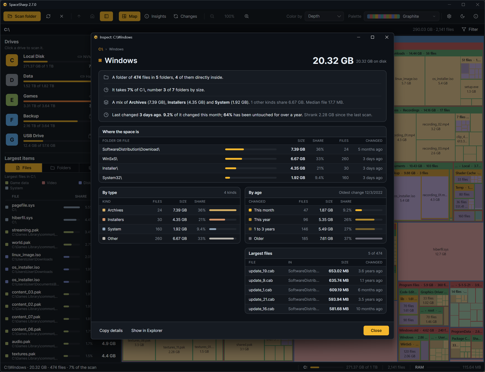
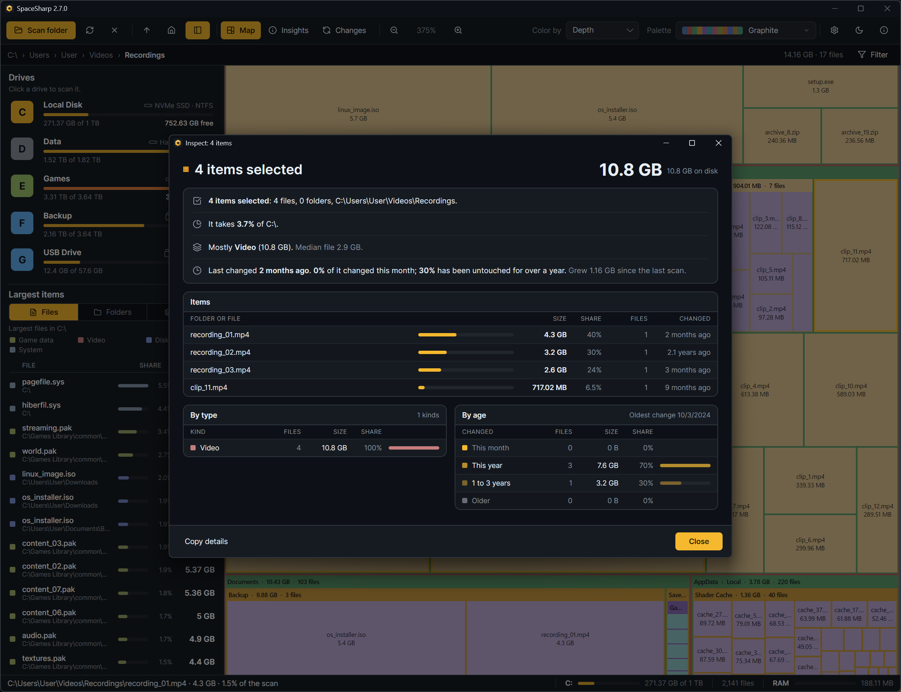

**Inspect** opens a window about one item, or about everything you have selected. Right-click › Inspect, or **Ctrl+I**.

## For one folder

- **The header**: the path as clickable crumbs, the name, and the size at the right with the size on disk beside it.
- **The story**: a card of short sentences, one line each. What it is ("A folder of 91,979 files in 9,428 folders, 14 of them directly inside"); what it takes ("24% of Local, number 2 of 118 folders by size, and 5% of C:\"); a note when one thing holds most of the folder, when it is hard-linked or when part of it could not be read; what it is mostly ("Mostly Databases (17.7 GB). 9 other kinds share 1.1 GB. Median file 415 KB."); and how old it is ("Last changed 6 days ago. 99% of it changed this month; 0.5% has been untouched for over a year. Unchanged since the last scan.").
- **Where the space is**: a table of the eight largest items at any depth, with a bar, size, share, how many files each holds and when it last changed, then one row for everything else. A folder's name is a click that zooms the map there.
- **By type**: a table of the kinds inside, seven of them and then "n more", each with its color, file count, size, share and a bar against the largest kind.
- **By age**: the same for the four age bands, with the oldest change in the heading.
- **Largest files**: the five biggest single files, the subfolder each sits in, its size and when it changed.

The window opens at 1000 × 1120 and scrolls when the screen is shorter; it remembers the width you give it.

## For one file

The type and extension, size and size on disk, when it was modified, its rank among its folder's files, and its change since the compared scan. Hard-linked files say they are already counted elsewhere.

## For a selection

Select several boxes (Ctrl+click, Shift+click, or Ctrl+A for the filter's matches) and Inspect sums them: total size, how many items in how many folders, the sentences and tables for the combined set, and the largest of them.

The path at the top is clickable crumbs; each zooms the map to that folder. **Esc** closes the window.
