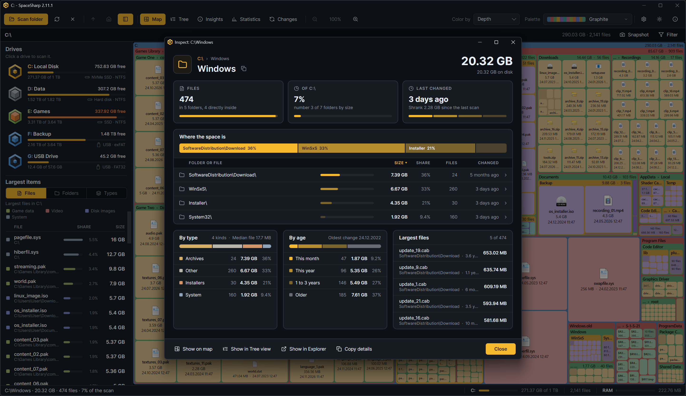
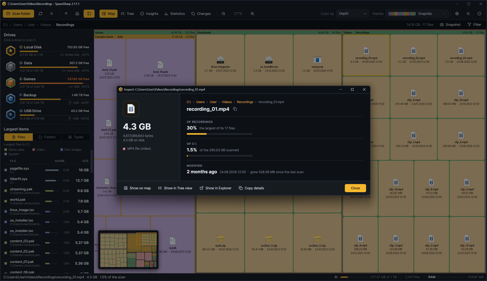
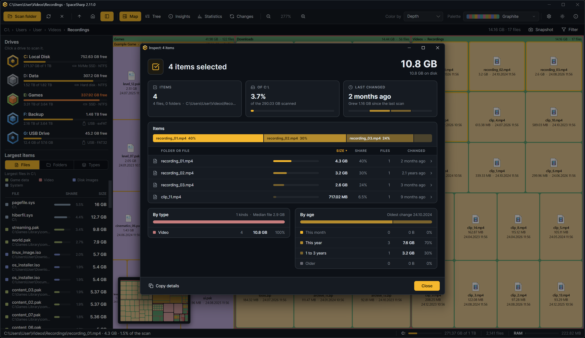

**Inspect** opens a window about one item, or about everything you have selected. Right-click › Inspect, or **Ctrl+I**.

## For one folder

- **The header**: a folder mark, the path as crumbs, the name with a button that copies the path, and the size at the right with the size on disk under it.
- **The figures**: a row of tiles, each one number with a line under it and a small bar. Files (how many, in how many folders, and how many items sit directly inside); the share of the parent folder with its rank ("the largest of its 46 folders"); the share of the whole scan; and when it last changed, with the oldest change inside, or what happened since the compared scan when there is one.
- **Notes**: a highlighted line when one thing holds most of the folder, with **Inspect it** to go straight to that item, and a line when the item is hard-linked or part of it could not be read.
- **Where the space is**: the folder as one bar divided among its largest items, with the names on the widest parts, then a table of those items at any depth with a bar, size, share, how many files each holds and when it last changed. Six rows show at first and **Show all** opens the rest, up to eight; one last line sums everything else. Click a column heading (Folder or file, Size, Files, Changed) to sort by it, and again to flip the order.
- **By type**: a bar divided among the kinds inside, then a line per kind with its color, file count, size and share, largest first; six kinds and then "n more". The heading carries the number of kinds and the median file size.
- **By age**: the same for the four age bands, with the oldest change in the heading.
- **Largest files**: the five biggest single files, each with the subfolder it sits in and when it changed, and its size.

## Moving around

The window does not have to close to look at something else. Click a row in Where the space is, a file in Largest files, a crumb in the path or **Inspect it**, and the window fills again for that item; the crumbs lead back up. The footer acts on whatever is inspected: **Show on map** closes the window and takes the item to the map, **Show in Tree view** does the same for the [Tree](Tree), **Show in Explorer** opens its folder, and **Copy details** puts everything the window shows on the clipboard as text.

The window opens 1120 wide and as tall as its content, and scrolls when the screen is shorter; it remembers the width you give it.

## For one file

A file has less to say, so it gets a smaller layout in two panes. At the left: Windows' icon for the file's kind (a program shows its own), the size with the exact bytes and the size on disk, and the type and extension with the kind's color. At the right: the path and name, then one row per figure, the file's share of its folder with its rank among that folder's files, its share of the scan, and when it was modified, with the exact time and how it changed since the compared scan. Hard-linked files say they are already counted elsewhere.

## For a selection

Select several boxes (Ctrl+click, Shift+click, or Ctrl+A for the filter's matches) and Inspect sums them: total size, how many files and folders in which folder, their share of the scan, the selected items as the table, and the type and age of the combined set.

**Esc** closes the window.
