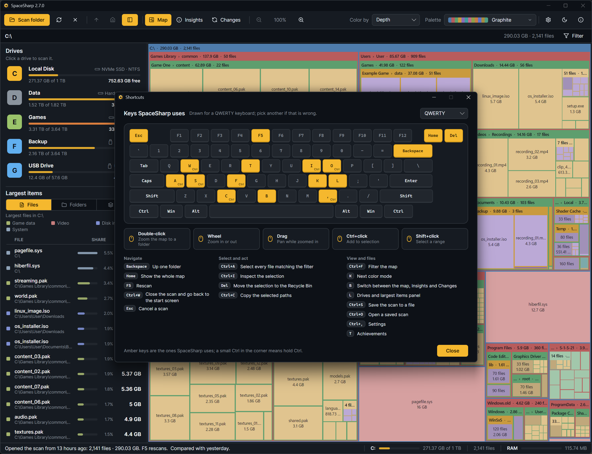

About › **Keyboard shortcuts** (or F1 › Shortcuts) draws this list on your own keyboard layout with the keys lit; the layout follows Windows and can be changed there (QWERTY, Nordic, QWERTZ, AZERTY, Spanish, Italian, Dvorak, Colemak). On a Mac, Ctrl reads ⌘.

## Navigate

| Key | Does |
|---|---|
| Double-click | Zoom the map to a folder |
| Backspace | Up one folder |
| Home | Show the whole map |
| Mouse wheel, + and − | Zoom in or out |
| Drag | Pan while zoomed in |
| F5 | Rescan |
| Ctrl+W | Close the scan and go back to the start screen |
| Esc | Stop a scan and go back to the start page; clear the filter; close the drawer |

## Select and act

| Key | Does |
|---|---|
| Click, Ctrl+click, Shift+click | Select; add to the selection; select a range |
| Ctrl+A | Select every file matching the filter |
| Ctrl+I | Inspect the selection |
| Del | Move the selection to the Recycle Bin |
| Ctrl+C | Copy the selected paths |
| Alt+Enter | Windows Properties for the selected item |
| Enter | Open the selected item |

## Map

| Key | Does |
|---|---|
| Ctrl+F | Filter the map |
| Ctrl+D | Find duplicate files in the scan |
| K | Next color mode |
| M | Switch between the Classic and Modern map styles |
| U | Physical or Uniform map |
| G | Show or hide free space |
| B | Switch between the map, Insights, Statistics and Changes |
| L | Drives and largest items panel |

## Scans and windows

| Key | Does |
|---|---|
| Ctrl+S | Save the scan to a file |
| Ctrl+O | Open a saved scan |
| Ctrl+, | Settings |
| T | Achievements |
| F1 | About, with the shortcuts window and the crash logs |

In the Changes view, **Enter** and the **Right** arrow open a folder in place, **Left** closes it or goes to its parent, and **Enter** on a file goes to it on the map.
