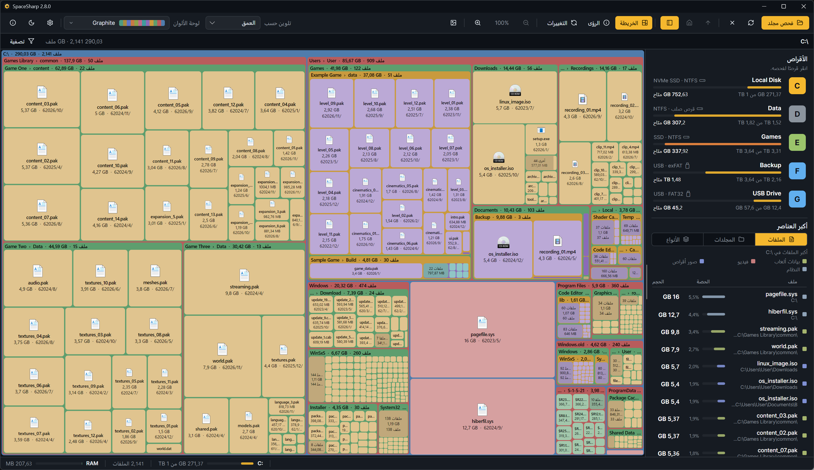

The interface comes in eighteen languages. English and Norwegian Bokmål are written by hand; the other sixteen are machine translations, marked as such in the language list, and corrections from native speakers are welcome ([Translating](Translating)).

| | | |
|---|---|---|
| English | German | Portuguese |
| Norwegian Bokmål | Spanish | Russian |
| Arabic | French | Swedish |
| Chinese (Simplified) | Italian | Turkish |
| Danish | Japanese | Ukrainian |
| Dutch | Korean | Polish |

**Choosing.** Settings › General › App language. "Same as Windows" follows the system language and falls back to English. A change takes effect after a restart, which the app offers at once.

**Right to left.** Arabic mirrors the whole window: the side panel moves to the right, the map's layout runs right to left, text aligns right. Developers can preview it in any language with `--rtl` ([Building from source](Building-from-Source#testing-right-to-left-and-clipped-text)).

**What is translated.** Every string the app shows, including the filter's descriptions, Insights' sentences and the shortcuts window. The filter's plain-words grammar itself (`over`, `older than`, `videos`) is English in every language, since it is parsed, not displayed; the drawer writes it for you.

**Dates and sizes** follow Windows' regional settings.
