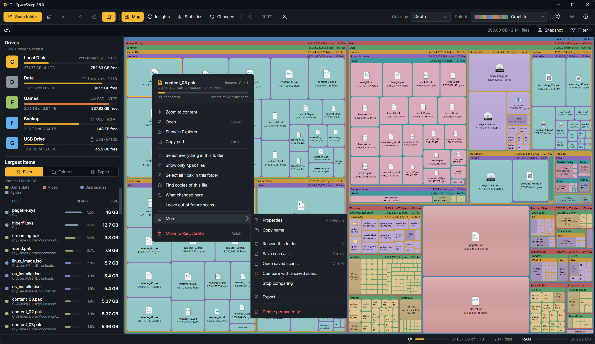
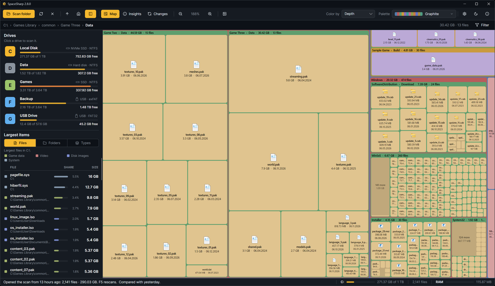

## Moving around the map

| Action | How |
|---|---|
| Zoom into a folder | Double-click it |
| Up one folder | **Backspace**, the Up button, or a crumb in the path row |
| The whole map | **Home**, or the home button |
| Zoom in and out freely | Mouse wheel, or **+** and **−** |
| Pan while zoomed in | Drag the map |
| Back to the start screen | **Ctrl+W**, the × next to Rescan, or Close the scan in the right-click menu |

Zoom animates by default (Settings › Behavior › Animate zoom).

Zooming in opens the groups of small files where there is room, and zooming back out closes them again, so the overview looks the same as before you went in.

## The minimap

Once you zoom in, a small card appears over a corner of the map: the scan's biggest folders as plain blocks with their names, laid out as on the map, and a box in the accent color where the map's window is. Click anywhere in it to put that spot in the middle of the map, or hold the button and drag to carry the view along. Right-click it to hide it. When the scan is mostly one folder inside another, the minimap shows the first level that has something to tell apart.

Settings › Behavior › Minimap picks the corner (bottom left by default), turns it off, or swaps it for **edge markers**: two thin bars on the map's bottom and right edges that show which part of the width and height you are on. They cover nothing and drag like scrollbars. At zoom 1 neither is shown, since there is nothing to locate.

## Saving the map as a picture

The **Snapshot** button in the path row, beside Filter, saves the map as you see it, zoom and all, to a PNG at twice the screen's pixels. The side panel, toolbar and path row are not in it.

## The path row

Under the toolbar: the path to the folder you are looking at, each part a button. On the right, the Filter button ([The filter](The-Filter)).

## The side panel

On the left; **L** or the panel button hides and shows it, and its edge drags to set its width.

- **Drives**: every drive as a tile tinted by its kind (amber NVMe, green SSD, grey spinning disk, blue removable, purple network, orange optical) with the letter on it, then its label, the kind with the icon Windows uses for it, how full it is, and free space. Click one to scan it. The line under the list drags to give the list more or less room.
- **Largest items**: a **Files / Folders / Types** switch, then the top of each. Before a scan the section is hidden and the drive list has the whole panel. Click a row to go to it on the map; hover for its path. The **Share** column shows each item's share of the scan.

## The three views

The toolbar switches what fills the map's place: **Map**, **Insights** ([Insights](Insights)), **Statistics** ([Statistics](Statistics)) and **Changes** ([Changes](Changes)); **B** cycles them. Zoom and the path row belong to the map; the other two have their own controls.

## The right-click menu

The menu shows only the rows that apply to what you clicked. At the top, the item itself: name, size, file and folder counts, when it last changed, and a bar for its share of its folder, with its share of the drive beside it (for a file, where it ranks among files of its type in that folder). Click that header for **Inspect** (Ctrl+I, [Inspect](Inspect)).

- **Zoom to folder** (on a file: Zoom to its folder, by name), **Open** (Enter), **Show in Explorer**, **Copy path** (Ctrl+C).
- **Select everything in this folder**. On a file also **Show only *.ext files**, **Select all *.ext in this folder**, and **Find copies of this file**, which opens Duplicates with the file picked out ([Duplicates and empty folders](Duplicates-and-Empty-Folders)).
- **What changed here** (when a compared scan is loaded): opens Changes at this folder ([Changes](Changes)).
- **Leave out of future scans**: adds the item's name to Settings › Scanning › Leave out, after telling you that every item of that name will be skipped.
- **More**: Properties (Alt+Enter), Copy name; Rescan this folder (F5), Save scan as… (Ctrl+S), Open saved scan… (Ctrl+O), Compare with a saved scan…, Stop comparing; **Export…** ([Exporting](Exporting)); and **Delete permanently** for the folders Explorer cannot open ([Cleaning up](Cleaning-Up)).
- **Move to Recycle Bin** (Del), on its own at the foot.

Up one folder, Show whole map and Close the scan left the menu; the toolbar, Backspace, Home and Ctrl+W do those.

## The status bar

Left: the hovered or selected item and its share of the scan, or the last thing that happened. Right: a meter of how full the drive is (orange from 85%, red from 92%), the file count, and SpaceSharp's own memory use as a bar against the PC's memory.

## Selecting several

Ctrl+click adds a box to the selection, Shift+click selects a range, and **Ctrl+A** selects every file the filter matches. The right-click menu, Inspect and Del act on the whole selection.
