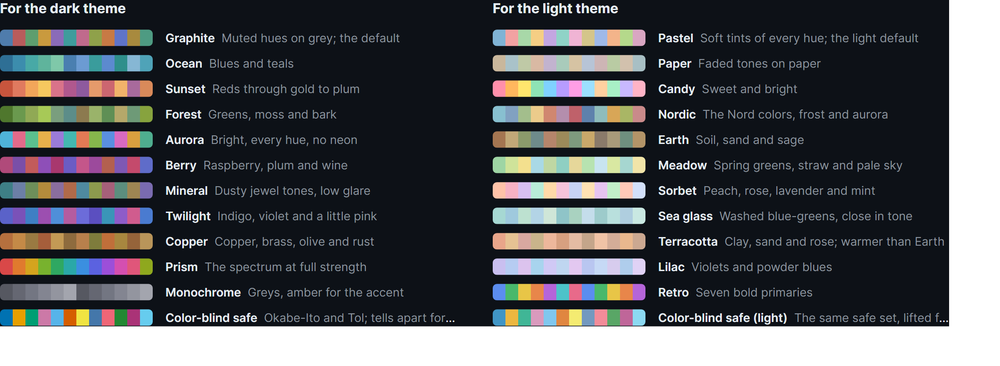
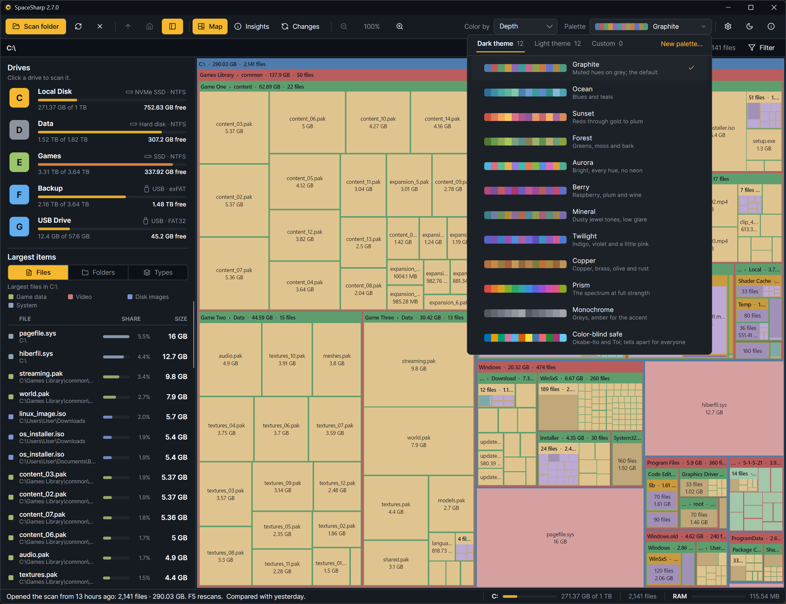

Three things decide how SpaceSharp looks: the **theme** (dark or light), the **look** (the window's own colors within that theme), and the **palette** (the colors of the boxes on the map).

## Palettes

Twenty-four built in, twelve per theme. Each has twelve folder hues, ordered so neighbors sit apart on the color wheel, with file tints and type colors derived from them.

| Dark theme | | Light theme | |
|---|---|---|---|
| **Graphite** | Muted hues on gray; the default | **Pastel** | Soft tints of every hue; the light default |
| **Ocean** | Blues and teals | **Paper** | Faded tones on paper |
| **Sunset** | Reds through gold to plum | **Candy** | Sweet and bright |
| **Forest** | Greens, moss and bark | **Nordic** | The Nord colors, frost and aurora |
| **Aurora** | Bright, every hue, no neon | **Earth** | Soil, sand and sage |
| **Berry** | Raspberry, plum and wine | **Meadow** | Spring greens, straw and pale sky |
| **Mineral** | Dusty jewel tones, low glare | **Sorbet** | Peach, rose, lavender and mint |
| **Twilight** | Indigo, violet and a little pink | **Sea glass** | Washed blue-greens, close in tone |
| **Copper** | Copper, brass, olive and rust | **Terracotta** | Clay, sand and rose; warmer than Earth |
| **Prism** | The spectrum at full strength | **Lilac** | Violets and powder blues |
| **Monochrome** | Grays, amber for the accent | **Retro** | Seven bold primaries |
| **Color-blind safe** | Okabe-Ito and Tol; tells apart for everyone | **Color-blind safe (light)** | The same safe set, lifted for light surfaces |

### The picker

The palette control in the toolbar shows a strip of the current palette's colors and its name. It opens a panel with three tabs, **Dark theme**, **Light theme** and **Custom**, each with its count; under them every palette is a strip of its twelve colors, its name and the line above. The one in use has a check, and the panel opens on the tab that holds it.

Picking a palette made for the other theme **switches to that theme** and uses it there; the tab says so first. If you would rather use light palettes on the dark theme or the other way around, turn on Settings › Treemap › **Use any palette on either theme**, and palettes are used as they are.

**New palette…** in the panel's corner opens the editor. Settings › Treemap › Palette is the same choice in another place.

## Custom palettes

Your own palettes live as JSON files in `%LocalAppData%\SpaceSharp\palettes` and show up in the picker's **Custom** tab. The **palette editor** (New palette… in the picker, or Settings › Treemap › Custom palettes) writes them for you, with twelve folder colors, the file tint, the type colors, readability checks and a sample map. [Custom palettes](Custom-Palettes) covers the editor and the file format.

## Looks

Settings › Appearance. **Dark look**: Graphite, Slate, Mocha, Midnight, GitHub Dark, Carbon. **Light look**: Paper, Linen, Mist, Sand, GitHub Light, Snow. The look colors the window, panels, menus and status bar; the map's palette is separate, so Graphite the look and Graphite the palette can be swapped independently.

There is one more of each that no picker lists: the **Gold** theme, which Settings › Appearance offers once every achievement is unlocked ([Achievements](Achievements)). Choosing it dresses the window in dark gilt and puts the Gold palette on the map, twelve metals from brass to rose gold; the palette then shows in the picker's Dark tab too. Your dark look and palette are kept, and come back when you switch away.

## Shading, text and grid

All under Settings › Treemap, with a sample map that follows every change; the [Settings reference](Settings-Reference#treemap) lists each control. The short version: cushion shading is off by default and the Soft preset is ready when you turn it on; Outlined labels helps if the map is hard to read; Density decides how early small files are grouped.
