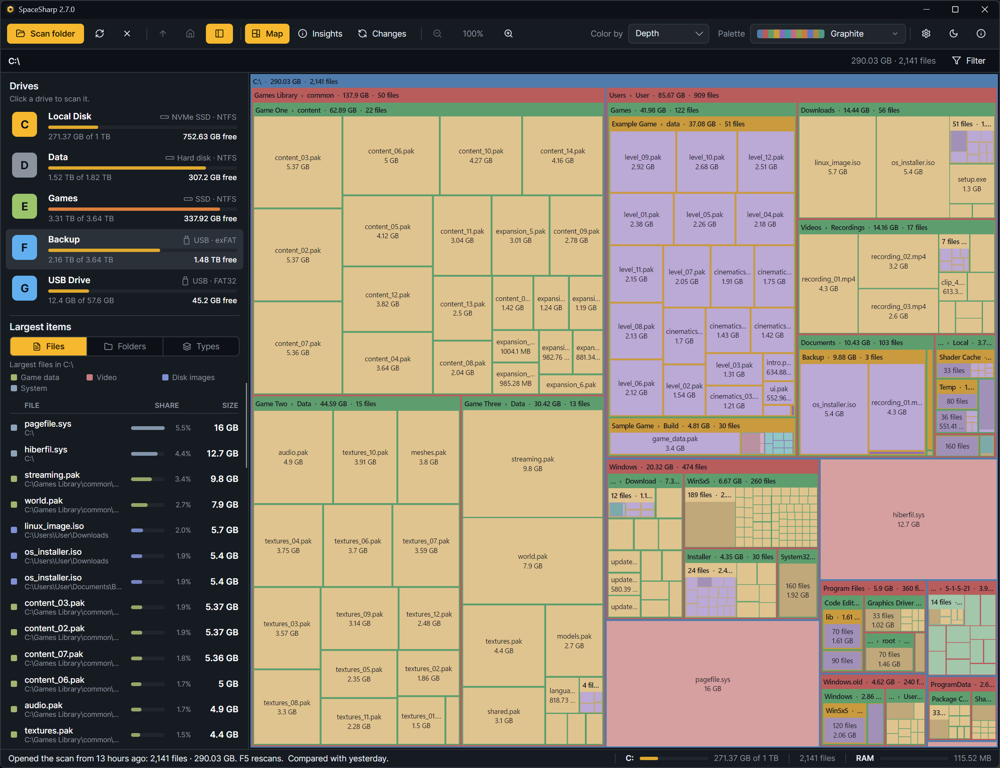
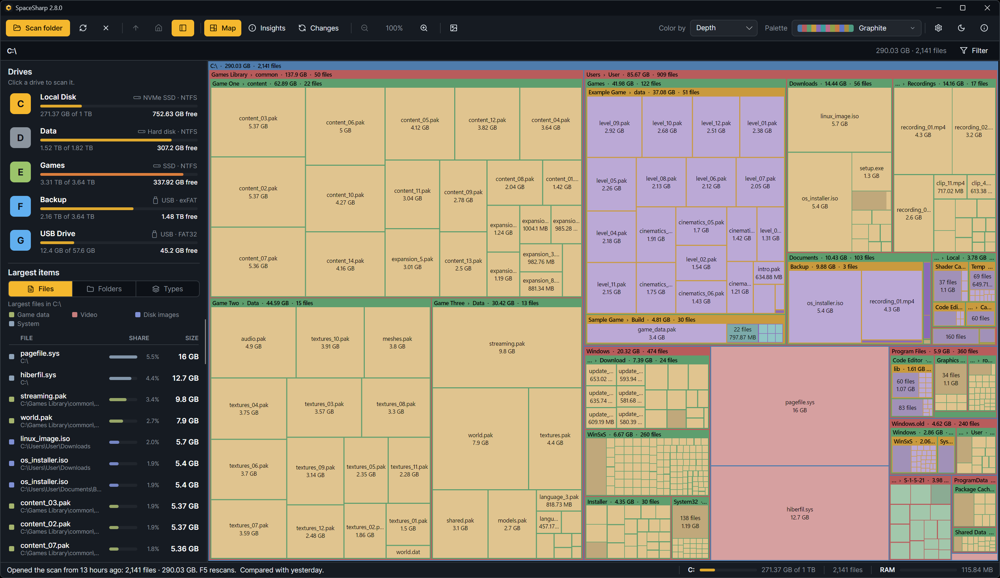
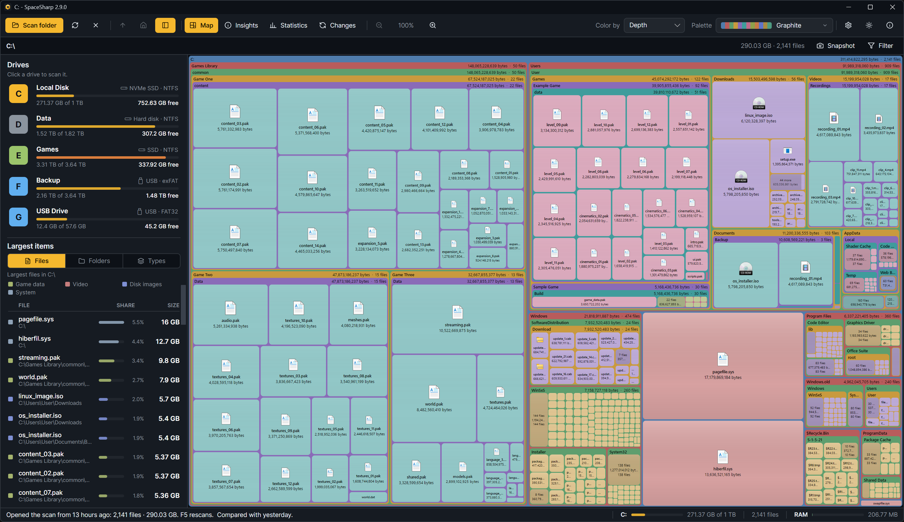
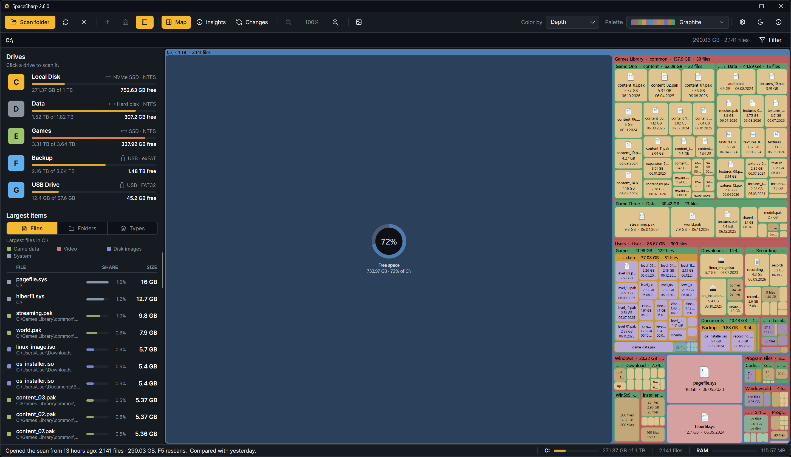
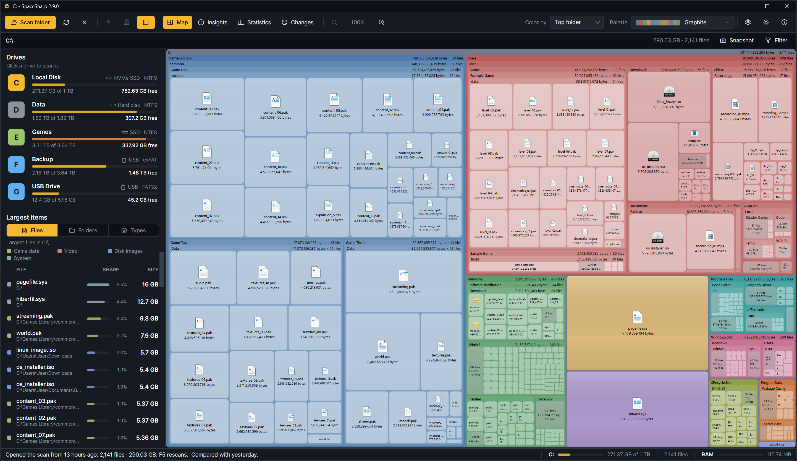
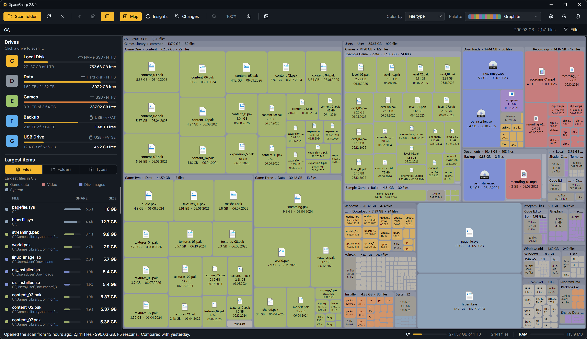
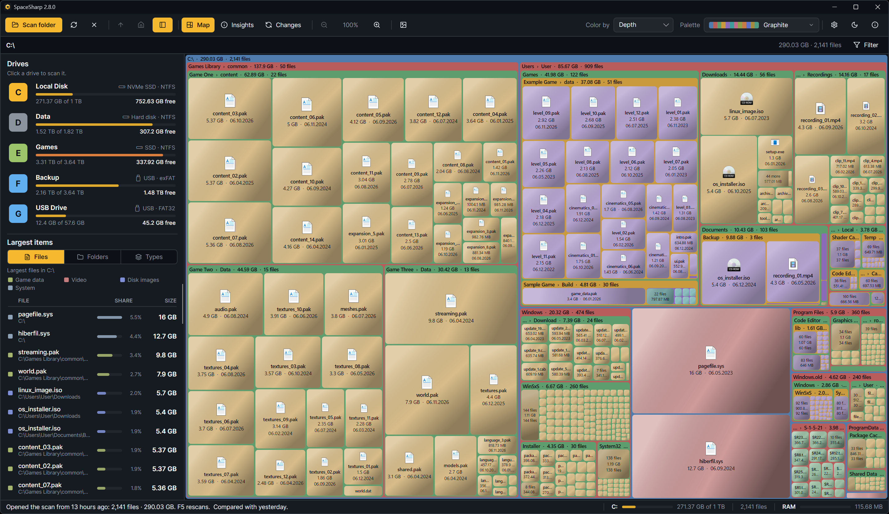

The map is a treemap: a rectangle for the whole scan, divided into rectangles for what is inside, divided again. The area of every box is proportional to the space it uses, so a folder that takes half the drive takes half the picture.

## Frames and boxes

- **Folders are frames** with a title bar: the name at the left and, if Settings › Treemap › Folders says so, the size and file count at the right. A bar too narrow for both keeps the name. Everything inside the frame is inside the folder.
- **Files are boxes** inside their folder's frame, with the name and size when there is room.
- **Small things are grouped.** Below a certain size the map draws one box labeled "312 files" instead of 312 slivers. Settings › Treemap › Layout › Density sets how early that happens; Everything turns grouping off.
- **Single-folder chains** such as `Users › you › AppData › Local` are drawn as one frame with a combined title unless Settings › Map › Merge single-folder chains is off.

## Two styles

Settings › Treemap › Style, or **M**, switches between **Modern** (rounded boxes with a gap around each, the file's icon, labels that shrink with the box) and **Classic** (square boxes, the grid, a name with the size under it: the map as it was before 2.8).

## Physical or Uniform

Settings › Treemap › Layout › Map, or **U**. Physical is the treemap: every box as large as the disk space it uses. Uniform keeps folders that way but draws every file inside a folder the same size, so a folder of a thousand small files reads as a thousand files rather than a sliver next to one big one. The files together still take exactly the room their bytes earn; only the split among them is even. Uniform is the default, since it keeps a map readable; switch to Physical when you want the biggest file to stand out at a glance.

## Free space

Settings › Map › Show free space, or **G**, draws the unused space of a whole-drive scan at the top level: in the Modern style a quiet panel with a ring showing how much of the drive is free, in Classic a gray block. It grows when you delete.

## Colors

**Color by**, in the toolbar, decides what the colors mean:

| Mode | Meaning |
|---|---|
| Top folder | One hue per top-level folder, lighter with each level inside. Good for "which part of the drive is this?" |
| Depth | A different color per nesting level, the way SpaceMonger did it. |
| File type | Files colored by what they are (video, images, archives, game data and so on); a legend appears. Folders stay neutral. |

The actual colors come from the **palette** ([Palettes and looks](Palettes-and-Looks)). Press **K** to cycle the modes.

The filter dims everything that does not match and leaves the layout alone, so you see where the matches are ([The filter](The-Filter)).

## Shading

By default files are flat. Settings › Treemap › Shading turns on **cushion shading**, light-to-dark across each box the way SpaceMonger drew them, with presets (Soft, Classic, Deep) and sliders for depth, spread, tone, fade inside folders and the light's direction. The sample map at the top of that page follows every change.

## Hover and select

Hovering a box shows a card with its size, size on disk, file count, last-modified date and, when a scan is compared, how it changed. The status bar shows the hovered item's share of the scan. Click to select; Ctrl+click adds, Shift+click selects a range; right-click for the menu ([Navigating](Navigating)).

## The map while a scan runs

During a folder walk the map **draws itself**. Finished folders appear as they finish, real files and all; folders still being read get a stand-in that fills as they go. Nothing jumps: boxes ease from where they were to where they belong, and because the last picture already is the finished tree, the end of the scan is a small settle rather than a reveal. Settings › Behavior › Draw the map as the scan goes turns it off, which keeps the previous map in view until the new one is ready.

A file-table scan has no tree until the whole table is read, so it arrives in one piece; a banner at the top of the map says so while it runs.

## Sizes

Settings › Map › Size measure picks between **File size** (the bytes in the file) and **Size on disk** (whole clusters, compressed size for compressed, sparse and cloud files, the way Explorer's "Size on disk" counts). Hard-linked data, such as Windows' WinSxS, is counted once (Settings › Scanning › Count hard links once, on by default), which is why totals can differ from Explorer ([FAQ](FAQ#why-is-the-total-different-from-explorer)).
