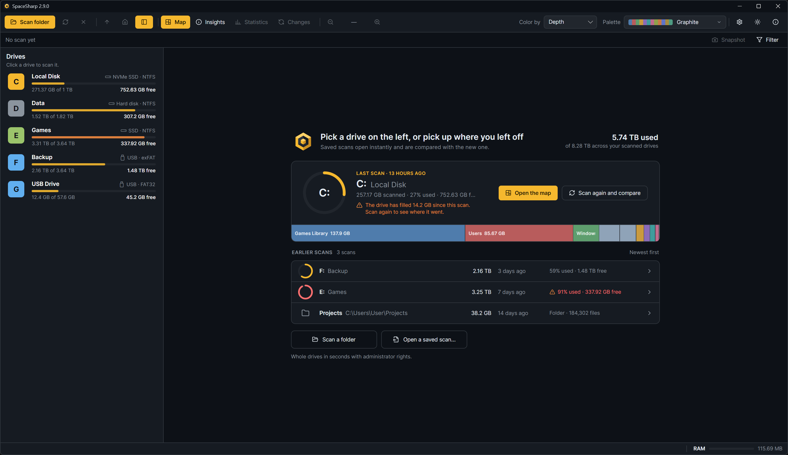

## The start screen

What you see when no scan is open. On the left, your drives; in the middle, before the first scan, a dashed slot where that scan will go, two sentences on what a scan is, and the three ways to start: scan the system drive now, scan a folder, open a saved scan. On Windows without administrator rights a card under it explains the file-table scan and offers the restart. Once you have scans:

- **Your last scan**, in a panel of its own: a ring showing how full the drive is *now*, "Last scan · 13 hours ago", the drive letter and label, what was scanned, and two buttons: **Open the map** (instant, from the saved file) and **Scan again and compare**, which scans the drive the way that scan was made (file table or folder walk, hidden files, hard links and exclusions as they were then, whatever Settings say now) and opens [Changes](Changes) when it is done. Along the foot of the panel runs a strip of the drive: its largest top-level folders and files left to right by size, each in a color of its own with its name and size inside when there is room, and "Everything else" as one grey segment at the end. Hover a segment for its name and size. The items come from the scan file's header, so the strip is there before anything is loaded; for a scan saved by a version before 2.7 the file is read in the background and the strip appears a moment later.
- A line under it when the drive has moved on: "The drive has filled 14 GB since this scan. Scan again to see where it went." in the warning color, or the quieter "The drive has 14 GB more free space than at this scan". It appears when the free space differs from the scan's by at least 1% of the drive and 500 MB.
- **Earlier scans**, newest first: a small ring, the name, the scanned size, when, and how full the drive is now; a drive at 85% or more shows in the warning color, and the same "filled since" mark appears as a tooltip. Folder scans show the folder icon, the path and the file count.
- **Scan a folder** and **Open a saved scan…** under the list, and the totals across your scanned drives at the top right.

**Ctrl+W**, the × next to Rescan, or right-click › Close the scan brings you back here from an open scan.

## Automatic saves

Every finished scan is saved to `%LocalAppData%\SpaceSharp\scans`:

| File | What it is |
|---|---|
| `C.sscan` | The last scan of drive C: |
| `C.prev.sscan` | The one before it, kept for comparison |
| `folder-3F2A9C1B4E.sscan` | The last scan of a folder (the name is a hash of the path) |

The next scan of the same place is compared with the saved one ([Changes](Changes)), then replaces it, and the old file becomes `.prev`. Opening a saved scan from the start screen is instant because the whole tree is in the file.

Settings › Behavior › **Keep saved scans for** (7 days to forever) prunes automatic saves older than that when the app starts. **Delete all saved scans**, under the same setting, first shows a table of what goes (each drive or folder with its label, when its saves were scanned, how many there are and what they take on disk) and afterward says how many went and how much was freed. The open map stays; if it was compared with one of the deleted scans, the comparison closes. Files you saved yourself are never touched by either.

## Saving and opening by hand

- Right-click › Scan file › **Save scan as…** (Ctrl+S) writes the open scan to an `.sscan` file wherever you like, with the drive name and date suggested as the file name.
- **Open saved scan…** (Ctrl+O), the start screen's button, double-clicking an `.sscan` file, or `SpaceSharp.exe scan.sscan` opens one. A scan of an unplugged drive opens fine; Insights just cannot show its free space.
- **Compare with a saved scan…** sets any file as the comparison for the open scan.

## The file

An `.sscan` is gzip-compressed and holds the full paths, sizes, dates and attributes of everything scanned, plus when it was made, how (file table or folder walk, with the hidden-file and hard-link settings), the drive's free space at the time and, since 2.7, the names and sizes of the largest top-level items for the start screen's strip. 2.7 still opens files saved by earlier versions. Never file contents. It is the same information the map shows, so treat it as you would a directory listing: fine to keep, worth thinking about before sending to someone.
