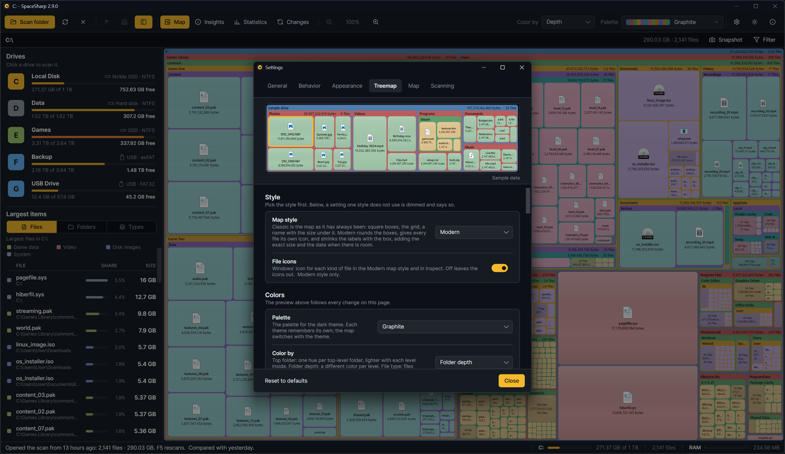
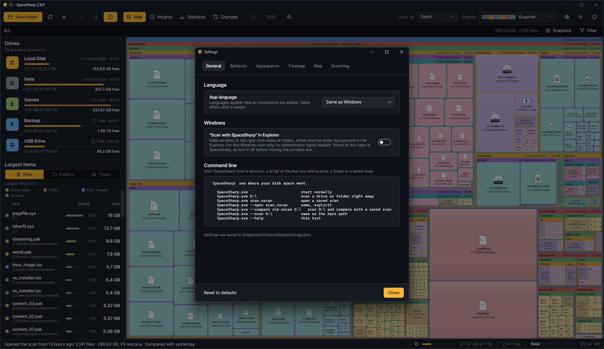
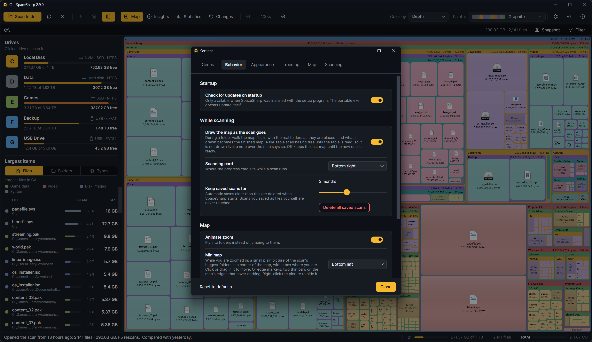
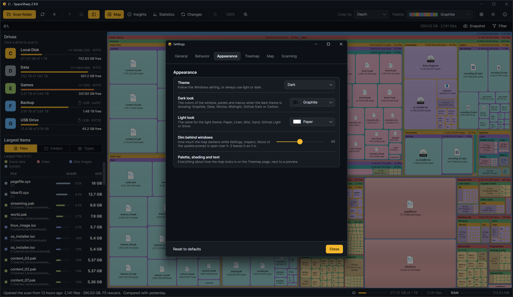
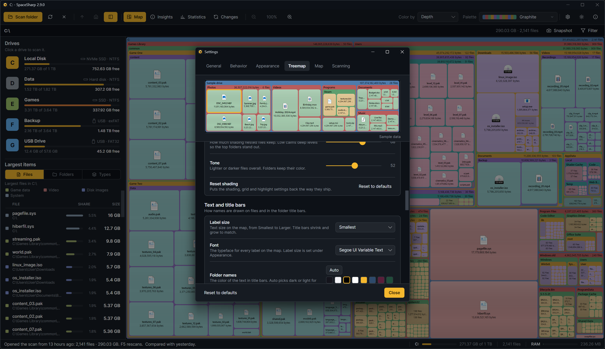
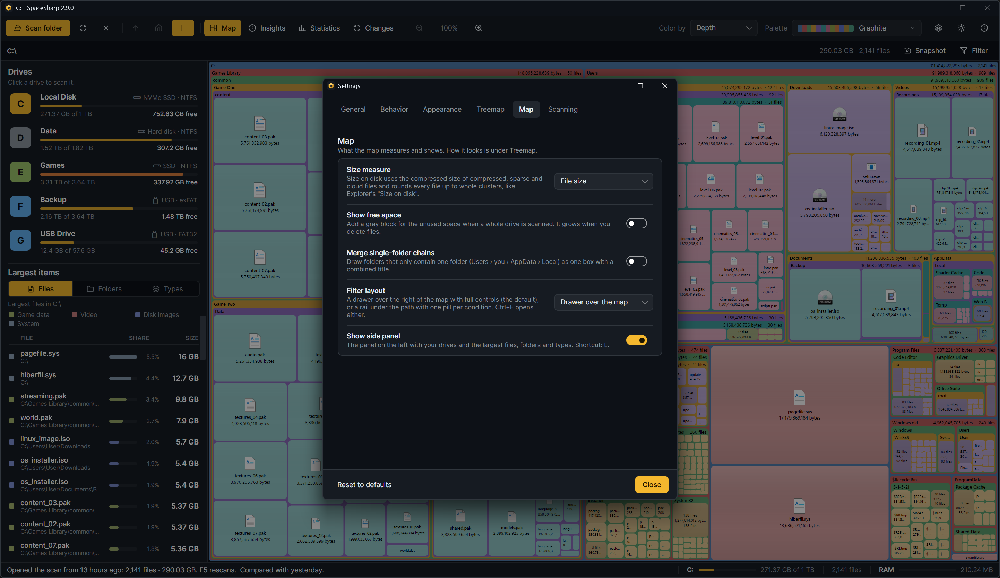
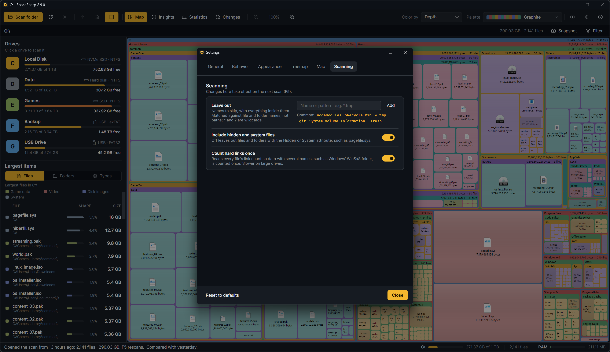

**Ctrl+,** or the gear in the toolbar. Settings are saved as they change to `%AppData%\SpaceSharp\settings.json`; **Reset** at the bottom puts everything back to the defaults listed here.

## General

| Setting | What it does | Default |
|---|---|---|
| App language | The interface language; "Same as Windows" follows the system. Takes effect after a restart. Machine translations are marked as such. | Same as Windows |
| "Scan with SpaceSharp" in Explorer | Adds an entry to the right-click menu of folders, drives and the folder background. For this Windows user only; no administrator rights. | Off |
| Command line | Not a setting: the ways to start SpaceSharp from a shortcut or script ([Command line](Command-Line)). | |

## Behavior

| Setting | What it does | Default |
|---|---|---|
| Check for updates on startup | Looks for a new release on GitHub a few seconds after start and offers to install it. Installed copies only; the portable exe does not update itself. | On |
| Draw the map as the scan goes | During a folder walk the map fills in as folders are placed, and what is drawn becomes the finished map. Off keeps the last map until the new one is ready. File-table scans arrive whole either way. | On |
| Scanning card | Where the progress card sits while a scan runs: bottom right, bottom left, top right, top left or center. | Bottom right |
| Keep saved scans for | Automatic saves older than this are deleted at startup: 7 days, 30 days, 3 months, 6 months, 1 year or forever. **Delete all saved scans** sits under it, asks with a table of what goes, and closes a comparison whose scan went with them. | 3 months |
| Animate zoom | Fly into folders instead of jumping. | On |
| Minimap | Shown while you are zoomed in. A corner (bottom left, bottom right, top left, top right) puts a small plain picture of the scan's biggest folders there, with a box where you are; click or drag in it to move. Edge markers puts two thin bars on the map's bottom and right edges instead, which cover nothing and drag like scrollbars. Off shows neither. | Bottom left |
| Confirm before moving to the Recycle Bin | Ask before deleting. Items inside Windows, program, app and game folders always ask, setting or not. | On |
| Hide unsafe empty folders | The empty folder list shows only folders that are plainly yours; the ones inside Windows, Program Files, ProgramData, AppData and game or build folders, which programs often expect to exist, are left out. Off lists them unticked, with a warning when you tick one ([Duplicates and empty folders](Duplicates-and-Empty-Folders#empty-folders)). | On |

## Appearance

| Setting | What it does | Default |
|---|---|---|
| Theme | Match Windows, Light or Dark. The theme button in the toolbar toggles it too. A fourth choice, Gold, appears once every achievement is unlocked: a dark, gilt look with its own map palette. | Match Windows |
| Dark look | The window, panel and menu colors in the dark theme: Graphite, Slate, Mocha, Midnight, GitHub Dark or Carbon. | Graphite |
| Light look | The same for the light theme: Paper, Linen, Mist, Sand, GitHub Light or Snow. | Paper |
| Dim behind windows | How much the map darkens behind Settings, Inspect, About and the update prompt; 0 turns it off. | 45% |

## Treemap

A sample map at the top of the page follows every change. Pick the style first: a setting that only one style uses says so in its description and is dimmed under the other.

**Style**

| Setting | What it does | Default |
|---|---|---|
| Map style | Classic is the map as it has always been: square boxes, the grid, a name with the size under it. Modern rounds the boxes with a gap around each, gives every file Windows' own icon for its kind, audio, video, picture, archive or document, not the icon of the program that opens it (a program's own icon arrives a moment later), and shrinks the labels with the box, adding the exact size and the date when there is room. Shortcut: M. | Modern |
| File icons | Windows' icon for each kind of file on the map and in Inspect. Off leaves them out. Modern only. | On |

**Colors**

| Setting | What it does | Default |
|---|---|---|
| Palette | The palette for the current theme; each theme remembers its own. The toolbar's picker is the same choice. | Graphite (dark), Pastel (light) |
| Color by | Top folder, Folder depth or File type ([Reading the map](Reading-the-Map#colors)). | Folder depth |
| Use any palette on either theme | Off: picking a palette made for the other theme switches to that theme. On: the palette is used as it is. | Off |
| Custom palettes | New palette…, Reload palettes, and the palettes folder ([Palettes and looks](Palettes-and-Looks)). | |

**Shading**

| Setting | What it does | Default |
|---|---|---|
| Look | How files are shaded: Off (flat colors), Edges, Pillow, Sheen, Layers or Side light. Each look has its own settings, shown under the picker, and keeps them when you switch away. | Sheen |
| Edges: Strength, Light from, Folder frames too | A one-pixel rim on every box, light on the lit side and dark opposite, like raised tiles; the colors stay flat. Folder frames can get the same rim at half strength. | 55%, top left, on |
| Pillow: Depth, Softness | Files are brightest in the middle and darken toward their edges. Depth is how dark the edges get, Softness how far the shadow reaches in. | 60%, 45% |
| Sheen: Strength, Spread | Light from the top of every file that fades out on the way down. Spread is how far down it reaches. | 44%, 78% |
| Layers: Strength, Sink folders | Files lie on their folder with a small shadow under them; Sink folders draws each folder as a shallow tray. Shows best in the Modern style, where boxes have gaps between them. | 50%, on |
| Side light: Strength, Light from | One even slope of light across every file, from the lit side to the dark one. | 55%, top left |
| Fade inside folders | How much shading nested files keep; low calms deep levels. Every look but Edges has it. | 68% |
| Tone | Lighter or darker shaded files overall; folders keep their color. | 52% |
| Reset shading | Shading, grid and highlight back to how they ship. | |

**Text and title bars**

| Setting | What it does | Default |
|---|---|---|
| Label size | Smallest to Larger; title bars shrink and grow to match. | Normal |
| Font | The typeface for every label on the map. | Segoe UI Variable Text |
| Folder names, File names and sizes | Text colors; Auto picks dark or light per box. | Auto |
| Outlined labels | A thin contrasting outline around every label, for readability on any color. | Off |
| Sizes as bytes | Every size on the map as the exact number of bytes, "534,312 bytes", instead of "521.8 KB". | Off |
| Files, Folders | What a file box and a folder title show: sizes and file counts, in Modern whether a file's date follows its size, and in Classic whether file names are centered (Modern always centers them). | Sizes and dates on; counts in folder titles on |
| Title bar padding | Space above and below a folder name. | |
| Title bar tint | How far the bar is shaded from the folder's own color; 0 is the same color. | 0 |

**Grid and highlight**

The Modern style has gaps between the boxes instead of a grid, so there only the highlight frame applies.

| Setting | What it does | Default |
|---|---|---|
| Highlight frame | The frame around selected boxes. | |
| Grid lines | A line between every box. Classic only. | Off |
| Grid line width | How thick, when on: 1 to 3. Classic only. | 1 |
| Grid color | Dark suits most palettes; light works on the darkest. Classic only. | |

**Layout**

| Setting | What it does | Default |
|---|---|---|
| Map | Physical sizes every box by the disk space it uses. Uniform keeps folders that way but draws every file in a folder the same size, so a folder of a thousand small files reads as a thousand files rather than a sliver. Shortcut: U. | Uniform |
| Density | How many small items are drawn before they are grouped into one "312 files" box: Sparse, Normal, Dense, Maximum, Everything (no grouping). | Dense |
| Bias | Whether the layout favors wide boxes or tall ones; Equal is the plain squarified layout. | Equal |
| Padding | Extra space around every box, on top of the 3 px gap the Modern style always keeps. | 0 |

## Map

What the map measures and shows; how it looks is under Treemap.

| Setting | What it does | Default |
|---|---|---|
| Size measure | File size, or Size on disk (whole clusters, compressed size for compressed, sparse and cloud files, like Explorer's "Size on disk"). | File size |
| Show free space | The unused space in a whole-drive scan as a block of its own: in Modern a quiet panel with a ring showing the free share, in Classic a gray block. Shortcut: G. | Off |
| Merge single-folder chains | Draw folders that only contain one folder as one box with a combined title. | On |
| Filter layout | Drawer over the map, or Rail under the path. | Drawer |
| Show side panel | The drives and largest items panel. Shortcut: L. | On |

## Scanning

Changes here take effect on the next scan (F5).

| Setting | What it does | Default |
|---|---|---|
| Leave out | Names to skip, with everything inside them. Matched against file and folder names, not paths; `*` and `?` are wildcards. Suggestions are offered. | Empty |
| Include hidden and system files | Off leaves out files and folders with the Hidden or System attribute, such as pagefile.sys. | On |
| Count hard links once | Reads every file's link count so data with several names (WinSxS) is counted once, the way the file-table scan always does, so two scans of the same drive agree. Slower on large drives. | On |

A scan's method and these three settings together decide whether two scans can be compared ([Changes](Changes#how-comparisons-happen)).
