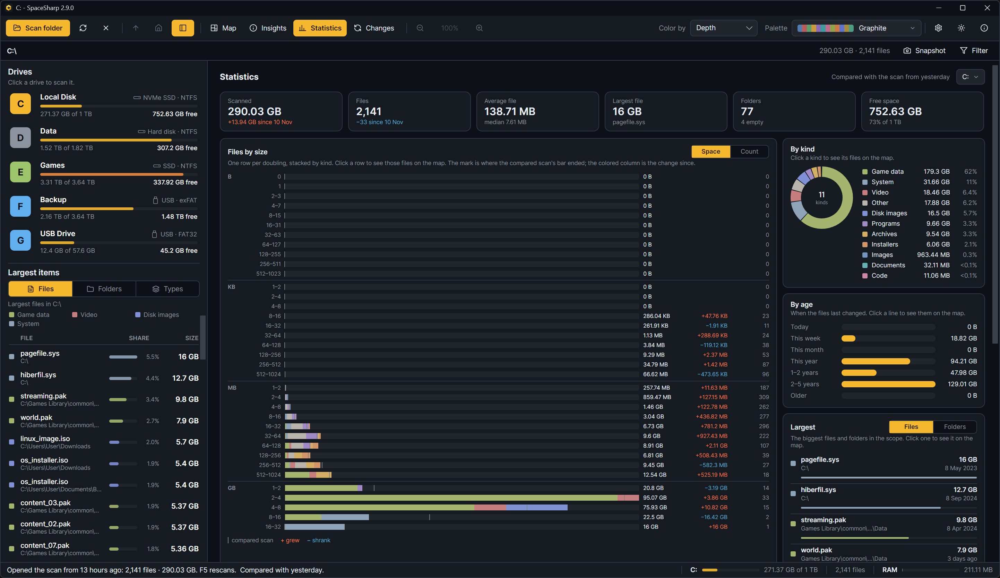

**Statistics** is the scan as a report. Where [Insights](Insights) reads the drive for you and points at what to do, Statistics lays out the numbers the way SpaceMonger's statistics page did, and then goes further: every figure is a click back to the map, and with a compared scan every figure carries its change. The Statistics button in the toolbar opens it; **B** cycles Map, Insights, Statistics and Changes.

## The scope

The picker at the top right names the folder the figures cover. It starts on the whole scan and offers the folders down to the one the map is in, and the biggest top-level folders. Pick one and every card recomputes for that folder; a click on any figure then opens the map inside it.

With a compared scan ([Changes](Changes)), the line beside the picker says which scan the deltas are against.

## The tiles

| Tile | What it says |
|---|---|
| **Scanned** | The bytes in the scope; with a comparison, the change since it, otherwise the share of the drive |
| **Files** | The file count; with a comparison, how many more or fewer |
| **Average file** | The mean file size, with the median under it, which says more about a drive full of small files |
| **Largest file** | Its size and name; click it to see it on the map |
| **Out of reach** | What the drive reports as used that the scan could not read, usually folders that need administrator rights ([Getting started](Getting-Started)). Shown for a drive scan; a folder scan shows the folder count instead |
| **Free** | The drive's free space and share; without a drive to ask, the deepest folder instead |

## Files by size

One row per doubling, from empty files up to the largest file's class: 1 byte, 2 to 3, 4 to 7, and so on, with the unit changing at the rules. Each bar is the class's share of the biggest class, stacked by kind in the palette's colors, with the total at its end and the file count at the right. Hover a row for the kinds in it; click a row to see those files on the map, with the filter set to the class's bounds.

**Space / Count** switches the bars between bytes and file counts. Bytes show where the space is; counts show the long tail of small files that the bytes hide.

With a compared scan, a thin mark on each bar shows where the earlier scan's bar ended, and a column between the total and the count shows the change since, grew in orange and shrank in blue, the same colors as [Changes](Changes). Files inside a folder that is gone entirely are known only as a total, so they count toward the Scanned tile but not toward any one row.

## By kind and by age

**By kind** is a donut with the number of kinds in its hole and one line per kind: size and share. Hover a line to lift its slice; click it to filter the map to that kind.

**By age** is seven lines, from files changed today to files older than five years, bars relative to the biggest. Click a line to see those files on the map.

## Largest

The biggest files or folders in the scope, switched with **Files** and **Folders**. A file shows where it is and when it last changed; a folder shows its share. Click one to see it on the map. A folder whose whole size is one subfolder is left out, since the subfolder says the same thing more precisely.

Slack space, tiny files, zero-byte files and empty folders, which used to sit here under "Worth a look", are in [Insights](Insights) under **Small and empty**, where they can be acted on.

## Extensions

The biggest extensions by space: kind, space, file count, average size, share of the scope, and with a comparison the change since it. **Show** filters the map to the extension. **Export…** saves every extension of the scope, not only the ones shown, as CSV or TSV in the delimiter the [Export window](Exporting) last used.

## Where the numbers come from

Everything is computed from the scanned tree, in one pass, when the view opens or the scope changes; a scan of a million files takes well under a second. Hard-link duplicates hold no bytes of their own and are left out of every distribution. Sizes follow the **Size** setting: file size or size on disk ([Settings reference](Settings-Reference)).
