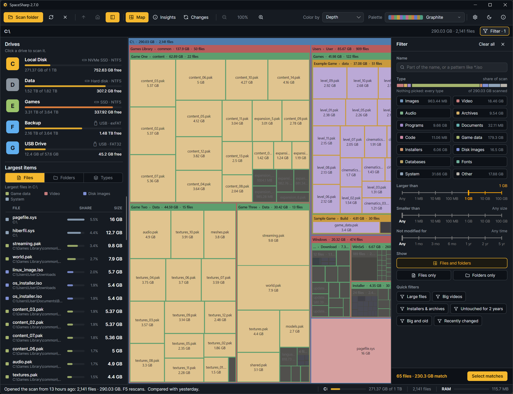
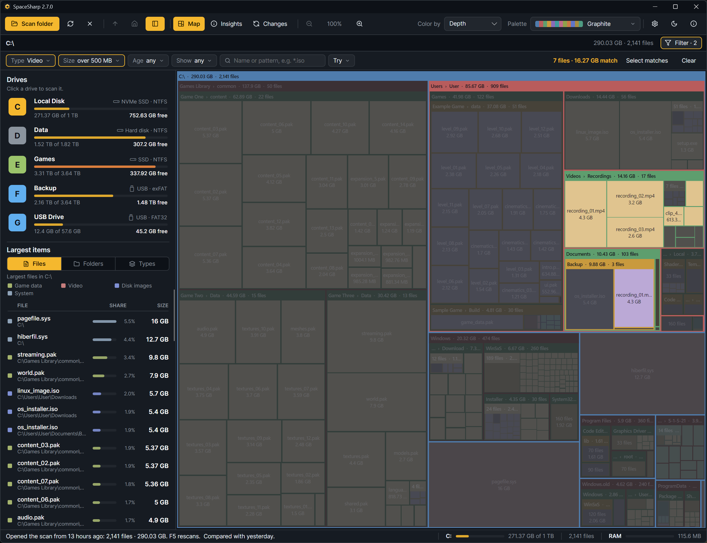
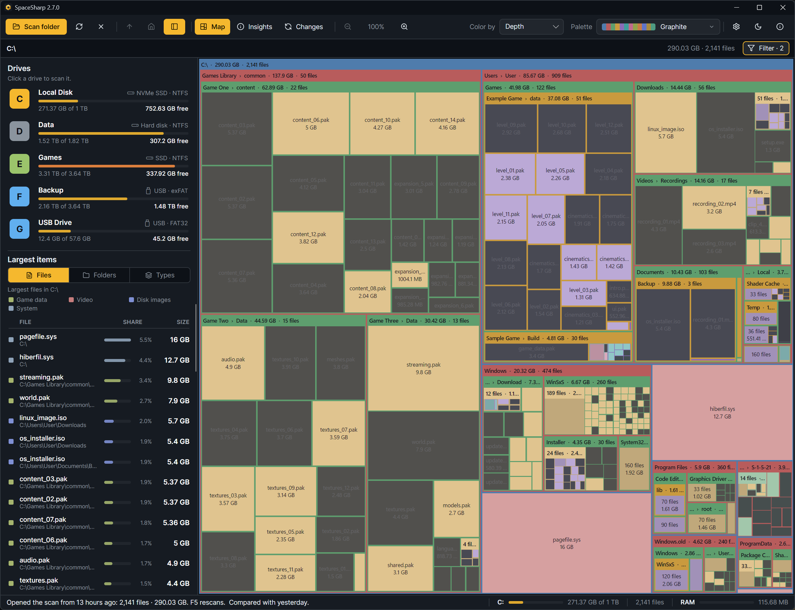

The filter narrows the map without changing it: matching boxes keep their color, everything else dims, so you see *where* the matches are, not only that they exist. **Ctrl+F** opens it; the Filter button in the path row does too.

## Plain words

Type what you are looking for. These all work, in any combination and order:

| You type | It means |
|---|---|
| `videos`, `photos`, `music`, `archives`, `programs`, `documents`, `code`, `game data`, `installers`, `iso`, `databases`, `fonts`, `system`, `other` | A file type. Several: `type:video,audio` |
| `over 500MB`, `larger than 2 GB`, `> 1gb`, `at least 10 MB` | At least this size (`b`, `kb`, `mb`, `gb`, `tb`) |
| `under 1 MB`, `smaller than 100kb`, `< 5gb` | At most this size |
| `older than 1 year`, `not modified in 6 months`, `untouched for 2 years`, `unused for 90 days` | Last changed before then (days, weeks, months, years) |
| `newer than 1 week`, `modified in the last 30 days`, `changed within 2 months` | Last changed since then |
| `.mp4`, `*.log`, `backup*`, `?.tmp` | An extension or a wildcard pattern on the name |
| `report`, `node_modules` | A word the name contains |
| `folders`, `is:folder` | Folders only |

Words like `and`, `with`, `the`, `show`, `find` are ignored, so `show me videos that are over 500MB and older than 1 year` reads as `type:video >500MB older than 1 year`. The canonical form is what the filter box shows after it has understood you.

## The drawer

The default filter face, a sheet over the right of the map, writes the same filter from controls:

- **Type**: a stacked bar of how the scan divides between file types, then one tile per type with its size; pick any number.
- **Larger than**, **Smaller than**, **Not modified for**: scales with seven ticks each; click a tick and the span lights up.
- **Show**: everything, files only, or folders only.
- **Quick filters**: Large files (`>1GB is:file`), Big videos (`type:video >500MB`), Installers & archives (`type:archives,programs >100MB`), Untouched for 2 years, Big and old (`>500MB older than 1 year is:file`), Recently changed (`newer than 1 week is:file`).

Settings › Map › Filter layout swaps the drawer for a **rail** under the path row, one pill per condition, for people who want the whole map visible while they filter.

## Acting on the matches

- The side panel and Insights keep showing the whole scan; the filter only affects the map.
- **Ctrl+A** (Select matches) selects every matching file. Then **Del** sends them to the Recycle Bin, **Ctrl+I** inspects them together, **Ctrl+C** copies their paths.
- Right-click › Export to CSV › Filter matches writes them to a file.
- **Esc** clears the filter when the filter box is not focused; a second Esc closes the drawer.

## Tips

- Right-click a file › **Show only this type** writes `*.ext` for you.
- Every row in Insights › By type is a click that filters the map to that type.
- A filter stays on while you zoom, so `older than 2 years` plus a dive into Downloads is a fast way to find forgotten installers.
