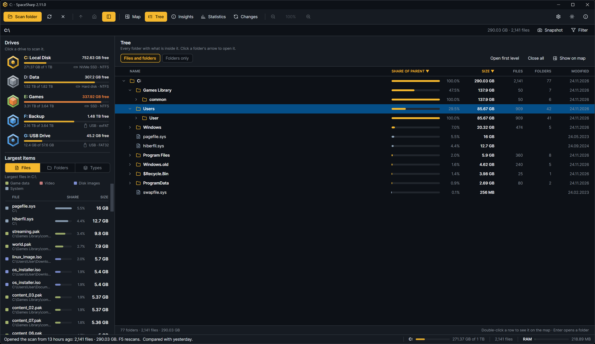

**Tree** is the scan as a table. Where the map shows everything at once, the tree shows one level at a time: the scanned drive or folder on the first line, what is inside it under that, and each folder opens in place when you want to see further down. It is the view to use when you think in folders and want exact figures side by side. The Tree button in the toolbar opens it; **B** cycles Map, Tree, Insights, Statistics and Changes. SpaceSharp remembers the tree as your view, so the next scan opens in it too.

## What the table shows

| Column | Meaning |
|---|---|
| Name | The folder or file, with an arrow for folders that have something to list. A lock marks a folder that could not be read in full |
| Share of parent | How much of the folder it is in this line takes up, as a bar and a percentage. Folders are amber; files take their type's color from the palette |
| Size | Its size, in file size or size on disk, whichever the map is set to |
| Files | For a folder, the files inside it at any depth |
| Folders | For a folder, the folders inside it at any depth |
| Modified | When it last changed; a folder carries the newest change inside it |

The first line is the scan itself, so its share is 100% and its size leaves out the drive's free space.

## Opening folders

Click a folder's arrow to open it, and again to close it. A folder with more than 300 lines shows the first 300 and a line that adds the next 300.

**Open first level** opens the folders directly under the scan, so you see two levels of the drive at once. It goes no deeper, and pressing it again changes nothing: folders further down are opened one at a time, so no click can unroll a whole drive. **Close all** folds everything back to the first level.

**Files and folders** and **Folders only** choose whether files are listed beside the folders. The choice is remembered.

## Sorting

Click a column header to sort by it; click it again to flip the order. Every folder's lines are sorted the same way, each within its own folder, so the tree keeps its shape. It starts with the largest first.

## From the map

Right-click a file or folder on the map and choose **Show in Tree view**. The view switches to Tree with the folders above the item opened, and its line selected and scrolled to. The folders you already had open stay open. With Folders only chosen, a file is shown by its folder.

## Back to the map

Double-click a line, or select it and press **Show on map**, to see it on the map: a folder becomes the view, and for a file the map zooms in on the file itself, selects it and flashes it.

| Key | Does |
|---|---|
| Up, Down | Move the selection |
| Right | Open the selected folder |
| Left | Close the selected folder, or go to the folder it is in |
| Enter | Open a closed folder; show anything else on the map |

The tree lists the whole scan. The filter belongs to the map, and is put away while the tree shows.
